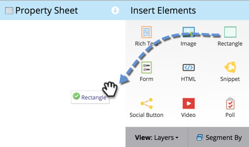
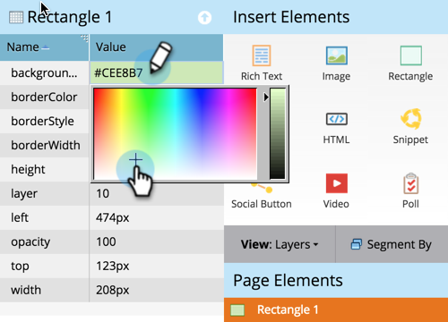

# Ajouter un rectangle à une page de destination à structure libre {#adding-a-rectangle-to-a-free-form-landing-page}

Les rectangles des pages de destination peuvent être utilisés pour mettre en surbrillance ou séparer visuellement des sections de contenu.

1. Sélectionnez une page de destination de forme libre et cliquez sur **[!UICONTROL Modifier le brouillon]**.

   

   >[!NOTE]
   >
   >Le concepteur de page de destination de forme libre s’ouvre dans une nouvelle fenêtre.

1. Faites glisser sur l’élément **[!UICONTROL Rectangle]**.

   

1. Sélectionnez votre rectangle et utilisez la **[!UICONTROL Feuille de propriétés]** pour apporter les modifications nécessaires.

   >[!TIP]
   >
   >Vous pouvez déplacer et redimensionner le rectangle par glisser-déposer. Essayez également les flèches sur le clavier ! Conseil : appuyez sur Maj-Flèche pour déplacer le rectangle de 10 px à la fois.

   

Vous pouvez désormais ajouter des rectangles à vos pages de destination de forme libre.
