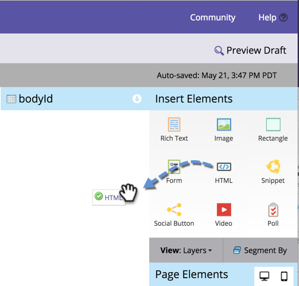
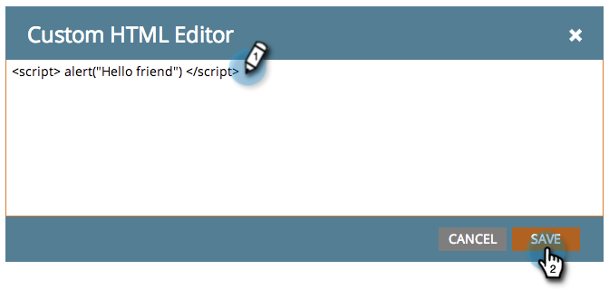

# Ajouter du HTML personnalisé à une page de destination à structure libre {#adding-custom-html-to-a-free-form-landing-page}

Vous pouvez ajouter des scripts personnalisés, des feuilles CSS ou d’autres HTML aux pages de destination.

>[!NOTE]
>
>La prise en charge de Marketo Engage n’est pas configurée pour vous aider à résoudre les problèmes liés aux HTML personnalisées. Pour obtenir de l’aide sur HTML, consultez un développeur web.

1. Sélectionnez votre page de destination et cliquez sur **[!UICONTROL Modifier le brouillon]**.

   

1. Dans l&#39;éditeur de landing page, faites glisser l&#39;élément ****.

   

1. Saisissez votre code HTML personnalisé, puis cliquez sur **[!UICONTROL Enregistrer]**.

   

Vous pouvez ajouter n’importe quel script ou CSS à l’élément HTML.

>[!TIP]
>
>Dans la mesure du possible, testez votre source HTML personnalisée dans un environnement local avant de la déployer dans une page de destination.

>[!CAUTION]
>
>Si votre HTML personnalisée n’effectue pas de rendu (par exemple une fonction JavaScript invisible ou CSS), placez l’élément à un emplacement mémorisable comme en haut à gauche. Le contour de l&#39;élément n&#39;est visible que lorsque vous cliquez dans sa zone.
