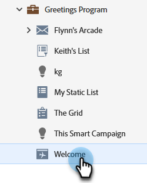
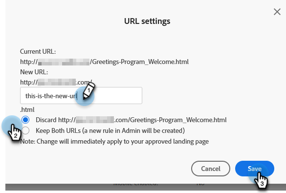

# Modifier l’URL de la page de destination {#change-the-landing-page-url}

Vous pouvez modifier l’URL d’une page de destination. Cela peut faciliter la mémorisation de l’URL et améliorer l’optimisation du référencement.

1. Recherchez et sélectionnez la page de destination de votre choix.

   

1. Cliquez sur le menu déroulant **Actions de la page de destination**, faites défiler l’écran jusqu’à **Outils d’URL** et sélectionnez **Paramètres d’URL**.

   

1. Saisissez la **[!UICONTROL Nouvelle URL]**, choisissez d’ignorer ou de rediriger l’ancienne URL, puis cliquez sur **[!UICONTROL Enregistrer]**.

   

   >[!NOTE]
   >
   >Si vous décidez de conserver les deux URL, une règle de redirection sera automatiquement créée. En savoir plus sur les [&#x200B; redirections d’URL &#x200B;](/help/marketo/product-docs/demand-generation/landing-pages/personalizing-landing-pages/redirect-a-url-path.md).
