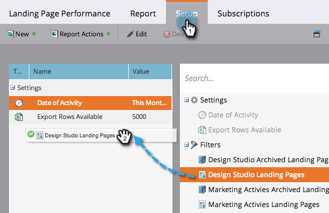

# Filtrer un rapport sur les performances des pages de destination {#filter-a-landing-page-performance-report}

Concentrez votre [rapport sur les performances des pages de destination](/help/marketo/product-docs/demand-generation/landing-pages/understanding-landing-pages/landing-page-performance-report.md) sur les pages de destination de vos programmes (ressources locales), de celles de [!UICONTROL Design Studio] (ressources globales) ou de celles qui ont été archivées.

1. Accédez à **[!UICONTROL Analytics]** (ou **[!UICONTROL Activités marketing]**).

   

1. Sélectionnez le rapport de la page de destination dans l’arborescence de navigation.

   

1. Cliquez sur l’onglet **[!UICONTROL Configuration]** et faites glisser un filtre.

   

   * **[!UICONTROL Pages de destination de Design Studio] :** ressources globales, gérées dans [!UICONTROL Design Studio].
   * **[!UICONTROL Pages de destination des activités marketing] :** ressources locales dans les programmes sur l’onglet [!UICONTROL Activités marketing].
   * **[!UICONTROL Pages de destination archivées] :** pages de destination inactives et retirées.

1. Choisissez les dossiers et les pages de destination spécifiques à inclure dans votre rapport.

   

   >[!TIP]
   >
   >Si vous sélectionnez un dossier, votre rapport inclura tout ce qu’il contient au moment de son exécution.

1. Vous avez terminé ! Cliquez sur l’onglet **[!UICONTROL Rapport]** pour afficher votre rapport filtré.

   
