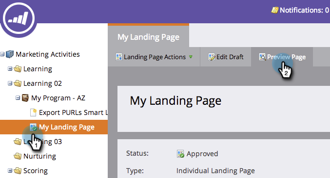
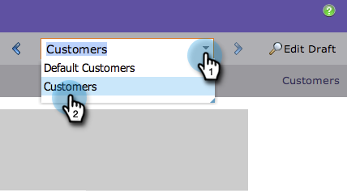

# Aperçu d’une page de destination avec du contenu dynamique {#preview-a-landing-page-with-dynamic-content}

Prévisualisez votre page de destination après avoir ajouté du contenu dynamique pour vous assurer que tout se présente comme il se doit.

>[!PREREQUISITES]
>
>* [Utilisation de contenu dynamique dans une page de destination](/help/marketo/product-docs/demand-generation/landing-pages/personalizing-landing-pages/use-dynamic-content-in-a-landing-page.md)
>* [Aperçu d’une page de destination](/help/marketo/product-docs/demand-generation/landing-pages/landing-page-actions/preview-a-landing-page.md)

1. Sélectionnez une page de destination et cliquez sur **[!UICONTROL Aperçu de la page]**.

   

1. Cliquez sur la liste déroulante et sélectionnez un **Segment** pour le prévisualiser.

   

Vous pouvez désormais vous assurer que vos pages de destination fonctionnent comme vous le souhaitez sur plusieurs segments.
