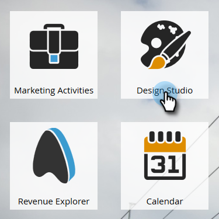
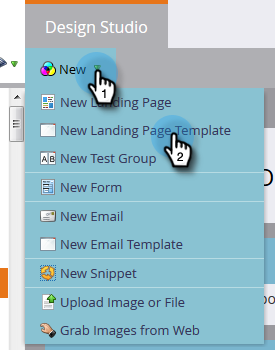
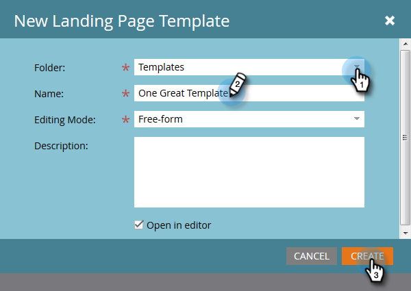
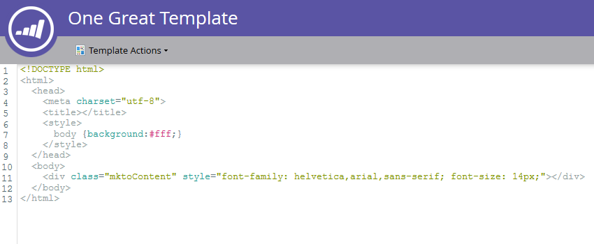
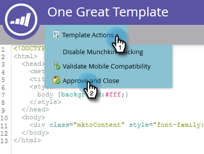

# Créer un modèle de page de destination à structure libre {#create-a-free-form-landing-page-template}

Les pages de destination à structure libre nécessitent moins de connaissances techniques que leurs homologues guidées. Pour créer un modèle pour les futures pages de destination, procédez comme suit.

1. Accédez à **[!UICONTROL Design Studio]**.

   

1. Cliquez sur **[!UICONTROL Nouveau]** puis sélectionnez **[!UICONTROL Nouveau modèle de page de destination]**.

   

1. Choisissez votre dossier, puis attribuez un nom à votre modèle. La forme libre est le mode de modification par défaut. Par conséquent, après avoir nommé votre modèle, cliquez sur **[!UICONTROL Créer]**.

   

1. Votre modèle doit s’ouvrir dans un nouvel onglet. Il est désormais modifiable par toute personne familière avec CSS/HTML.

   

   >[!NOTE]
   >
   >La prise en charge de Marketo n’est pas configurée pour vous aider à résoudre les problèmes liés aux HTML personnalisées. Pour obtenir de l’aide sur HTML, consultez un développeur web.

1. Lorsque vous avez terminé d’apporter des modifications, cliquez sur **[!UICONTROL Actions de modèle]**, puis sélectionnez **[!UICONTROL Approuver et fermer]**.

   

   >[!NOTE]
   >
   >Sélectionnez **[!UICONTROL Désactiver le suivi Munchkin]** si vous souhaitez empêcher le pré-remplissage des formulaires ou simplement ne pas suivre le comportement web sur une page spécifique.
   >Sélectionnez **[!UICONTROL Valider la compatibilité mobile]** pour vous assurer que votre code est compatible avec les appareils mobiles.

   >[!MORELIKETHIS]
   >
   >* [Créer une page de destination de forme libre](/help/marketo/product-docs/demand-generation/landing-pages/free-form-landing-pages/create-a-free-form-landing-page.md)
   >* [Créer un modèle de page de destination guidée](/help/marketo/product-docs/demand-generation/landing-pages/landing-page-templates/create-a-guided-landing-page-template.md)
   >* [Compréhension des pages de destination de forme libre par rapport aux pages de destination guidées](/help/marketo/product-docs/demand-generation/landing-pages/understanding-landing-pages/understanding-free-form-vs-guided-landing-pages.md)
