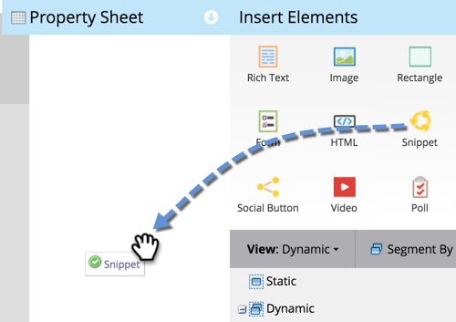
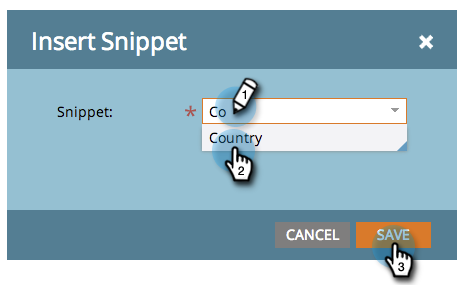

# Ajouter un extrait à une page de destination {#add-a-snippet-to-a-landing-page}

Les extraits sont des blocs réutilisables d’HTML qui peuvent suivre des règles et contenir du contenu personnalisé.

>[!PREREQUISITES]
>
>[Créer un fragment de code](/help/marketo/product-docs/personalization/segmentation-and-snippets/snippets/create-a-snippet.md)

1. Sélectionnez votre page de destination et cliquez sur **[!UICONTROL Modifier le brouillon]**.

   

1. Dans l’éditeur de page de destination, faites glisser sur l’élément **[!UICONTROL Extrait de code]**.

   

1. Recherchez votre fragment de code, sélectionnez-le, puis cliquez sur **[!UICONTROL Enregistrer]**.

   

   >[!TIP]
   >
   >Si vous ne trouvez pas votre fragment de code, assurez-vous qu’il est approuvé en premier.

   >[!NOTE]
   >
   >Si vous souhaitez ajouter un fragment de code à une page de destination guidée, reportez-vous à [cet article](/help/marketo/product-docs/demand-generation/landing-pages/landing-page-templates/create-a-guided-landing-page-template.md).

Vous savez maintenant comment ajouter des fragments de code à vos pages de destination.
