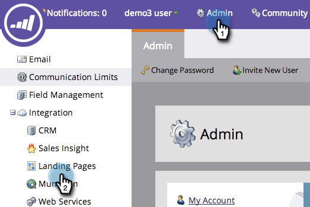
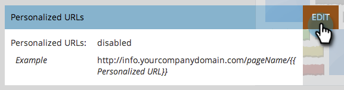
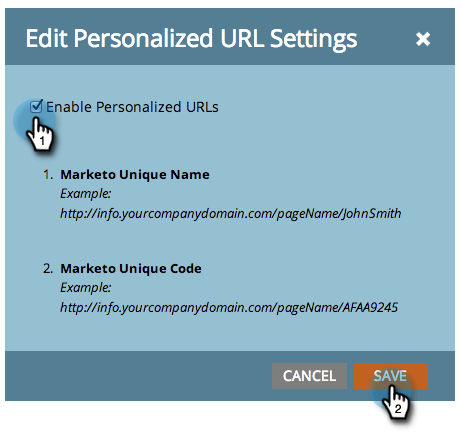

# Activer les URL personnalisées pour votre compte {#enable-personalized-urls-for-your-account}

Les URL personnalisées fonctionnent bien pour les campagnes par courrier imprimé.

>[!NOTE]
>
>**Autorisations d’administration requises**

1. Accédez à la section **[!UICONTROL Admin]** et cliquez sur **[!UICONTROL Pages de destination]**.

   

1. Cliquez sur **[!UICONTROL Modifier]**.

   

1. Cochez la case **[!UICONTROL Activer les URL personnalisées]** et cliquez sur **[!UICONTROL Enregistrer]**.

   

Vous avez activé les PURL pour votre compte. Vous pouvez désormais les activer pour des pages de destination individuelles.

>[!NOTE]
>
>Si deux personnes portent le même nom et/ou prénom, le système ajoute automatiquement un numéro à la fin de leur nom de PURL.
>
>Exemple :
>
>1. AnnaJones
>1. AnnaJones2
>1. AnnaJones3
