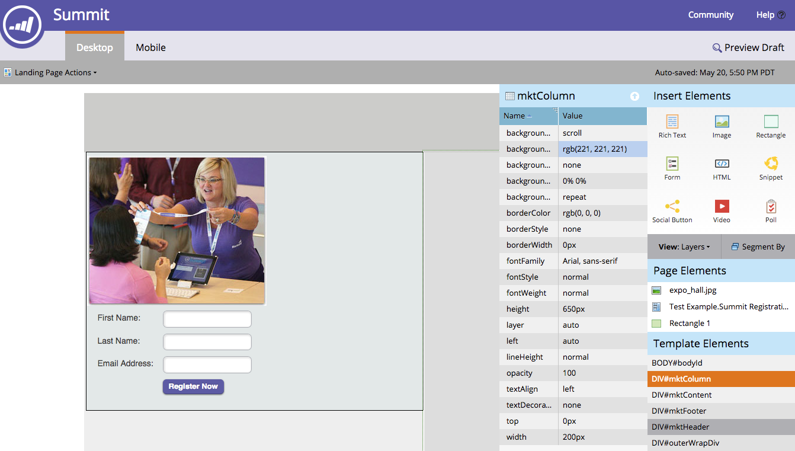
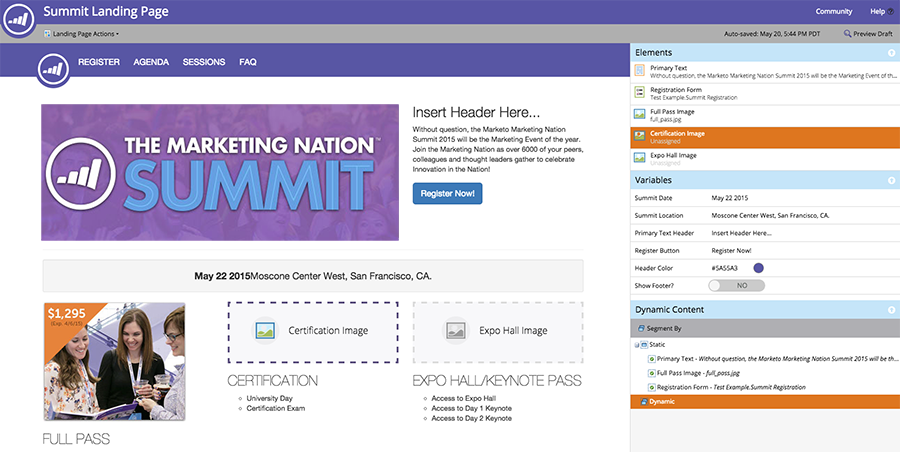

# Présentation des pages de destination à structure libre par rapport aux pages de destination guidées {#understanding-free-form-vs-guided-landing-pages}

Le modèle que vous choisissez détermine le mode de modification de la page de destination dans lequel vous allez travailler. Il existe deux chemins possibles : [libre](/help/marketo/product-docs/demand-generation/landing-pages/free-form-landing-pages/create-a-free-form-landing-page.md) et [guidé](/help/marketo/product-docs/demand-generation/landing-pages/guided-landing-pages/create-a-guided-landing-page.md). Vous trouverez ci-dessous un bref résumé des principales différences.

## Pages à structure libre {#free-form-pages}

* Effectuez un glisser-déposer du contenu de votre choix, où vous souhaitez le placer.
* Le modèle est comme un [!DNL SlideMaster] dans [!DNL PowerPoint], juste un arrière-plan.
* Créez une version mobile simple de votre page en un clic de bouton.
* Idéal lorsque vous ne disposez pas de beaucoup de temps ou de ressources techniques.

## Pages guidées {#guided-pages}

* Disposition/structure prédéfinie pilotée par le modèle.
* Seules les régions ou variables définies comme modifiables dans le modèle peuvent être personnalisées dans l’éditeur.
* Modifications de code requises pour modifier la disposition et ajouter des ressources supplémentaires.
* L’apparence sur l’ensemble des appareils est déterminée par les règles intégrées au modèle.
* Idéal si vous avez codé ou acheté des modèles réactifs ou si vous souhaitez modifier un modèle Marketo préconfiguré.

