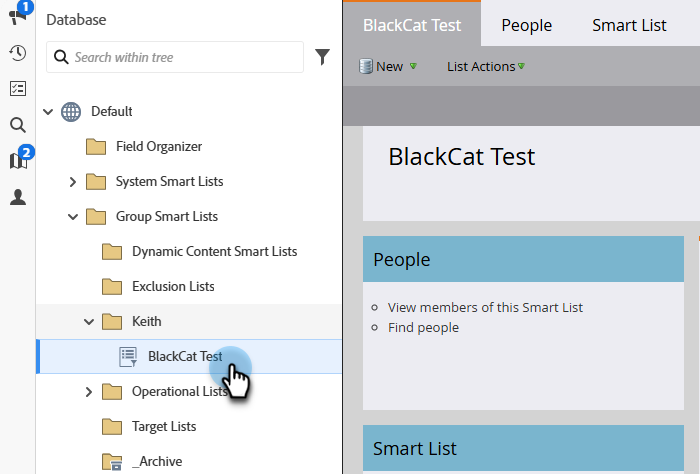
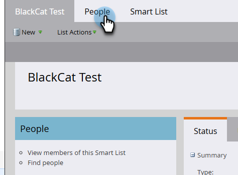
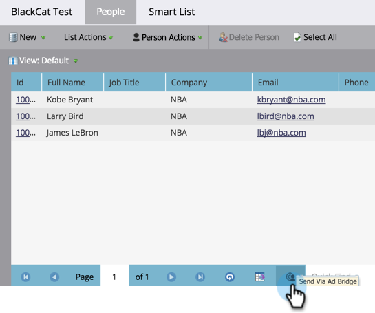
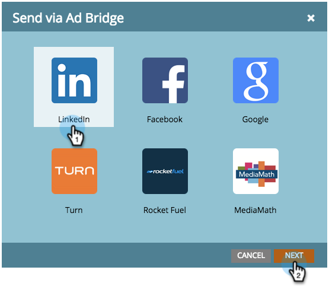
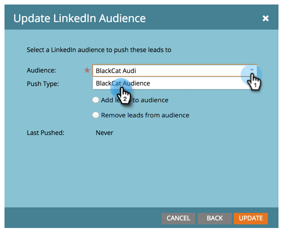
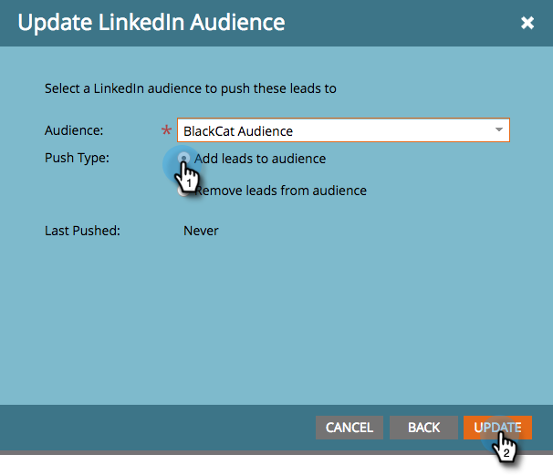

# Utiliser une liste Marketo ou une liste intelligente comme segment ciblé LinkedIn {#use-a-marketo-list-or-smart-list-as-a-linkedin-audience-segment}

Intégrez vos utilisateurs Marketo Engage à vos audiences LinkedIn.

>[!PREREQUISITES]
>
>[Ajout d’audiences correspondantes LinkedIn en tant que service LaunchPoint](/help/marketo/product-docs/demand-generation/ad-network-integrations/add-linkedin-matched-audiences-as-a-launchpoint-service.md){target="_blank"}

1. Accédez à la **[!UICONTROL Base de données]**.

   

1. Sélectionnez une liste dynamique.

   

1. Cliquez sur l’onglet **[!UICONTROL Personnes]**.

   

1. Cliquez sur l’icône **[!UICONTROL Envoyer via Ad Bridge]**  au bas de la liste.

   

   >[!NOTE]
   >
   >Lors de l’utilisation d’intégrations de réseau publicitaire pour envoyer une audience à LinkedIn, Marketo envoie uniquement l’adresse e-mail.

1. Sélectionnez **[!UICONTROL LinkedIn]** et cliquez sur **[!UICONTROL Suivant]**.

   

1. Sélectionnez une **[!UICONTROL audience LinkedIn]**.

   >[!NOTE]
   >
   >Cliquez sur **[!UICONTROL +Nouvelle audience]** pour créer une audience dans LinkedIn Campaign Manager.

   

   >[!NOTE]
   >
   >LinkedIn a abandonné les API utilisées pour le type de notification push « Effacer l’audience et ajouter des prospects » en mars 2018. Cette option n’est plus disponible à compter de la version de Marketo du 1er trimestre 2018.

1. Sélectionnez un **[!UICONTROL type push]**. Cliquez sur **[!UICONTROL Mettre à jour]**.

   

   >[!NOTE]
   >
   >Patientez 15 minutes pour que la synchronisation se termine.

Vos données vont maintenant être synchronisées avec les audiences de LinkedIn. Pour plus d’informations sur le téléchargement de listes vers LinkedIn pour le ciblage des comptes et des contacts, consultez [Centre d’aide des solutions marketing de LinkedIn](https://www.linkedin.com/help/lms/answer/73938?query=ad%20segment){target="_blank"}.
