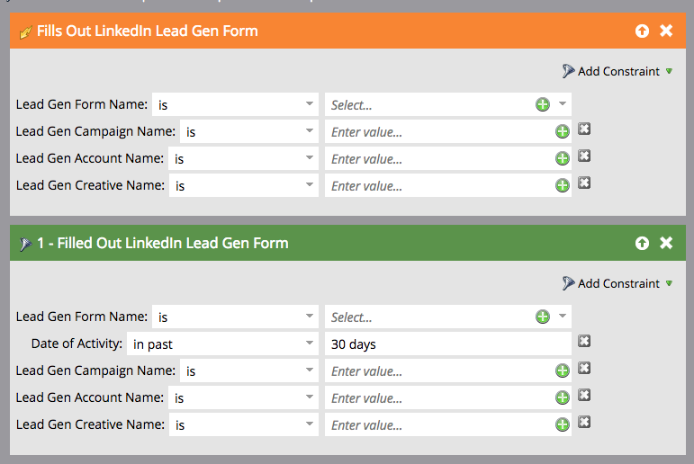
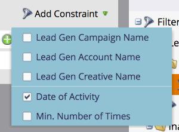

# Utiliser les filtres et déclencheurs des formulaires de génération de leads LinkedIn dans une campagne intelligente {#use-linkedin-lead-gen-form-filters-and-triggers-in-a-smart-campaign}

Lorsque vous avez activé Forms de génération de leads LinkedIn, vous pouvez les utiliser comme filtres et déclencheurs dans vos campagnes intelligentes.

>[!NOTE]
>
>Lorsque les personnes envoient leurs informations dans un formulaire de génération de leads LinkedIn, ces informations sont immédiatement transmises à Marketo, ce qui rend le formulaire disponible dans le menu déroulant Nom du formulaire de génération de leads. Les noms des formulaires ne seront pas visibles tant qu’au moins une personne n’aura pas envoyé le formulaire.

1. Utilisez le déclencheur **[!UICONTROL Remplit le formulaire LinkedIn de génération de leads]** pour agir immédiatement ou le filtre **[!UICONTROL Remplir le formulaire LinkedIn de génération de leads]** pour les campagnes par lots planifiées ou le filtrage de liste dynamique standard.

   

1. Ajoutez des contraintes pour affiner davantage vos résultats.

   
