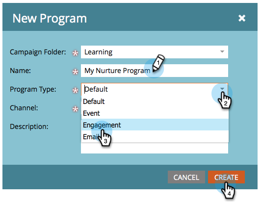

# Créer un programme d’engagement {#create-an-engagement-program}

Vous pouvez utiliser des programmes d’engagement dans Marketo pour faciliter la fidélisation par e-mail.

1. Accédez à **[!UICONTROL Activités marketing]**.

   

1. Sélectionnez le dossier dans lequel vous souhaitez créer le programme d’engagement, puis cliquez sur **[!UICONTROL Nouveau]** et **[!UICONTROL Nouveau programme]**.

   

1. Saisissez un **[!UICONTROL Nom]**, sélectionnez **[!UICONTROL Engagement]** pour **[!UICONTROL Type de programme]** et cliquez sur **[!UICONTROL Créer]**.

   

   

   >[!MORELIKETHIS]
   >
   >* [Ajouter du contenu à un stream](/help/marketo/product-docs/email-marketing/drip-nurturing/creating-an-engagement-program/add-content-to-a-stream.md)
   >* [Définir le rythme du stream](/help/marketo/product-docs/email-marketing/drip-nurturing/engagement-program-streams/set-stream-cadence.md)
