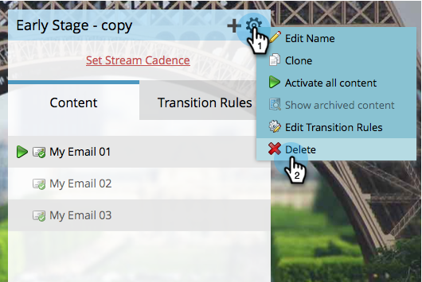
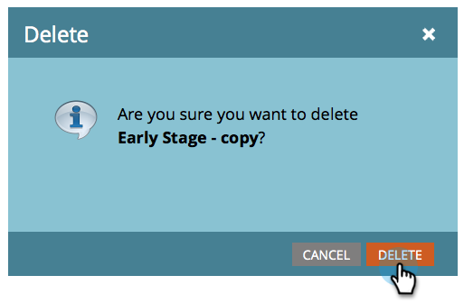

# Supprimer un flux {#delete-a-stream}

Si vous devez supprimer un flux de votre programme d’engagement, procédez rapidement et facilement comme suit.

1. Accédez à **[!UICONTROL Activités marketing]**.

   

1. Sélectionnez votre programme d’engagement et accédez à **[!UICONTROL Flux]**.

   

   >[!CAUTION]
   >
   >La suppression d’un flux entraîne la perte des données historiques pour le contenu de ce flux.

1. Cliquez sur l’icône d’engrenage et sélectionnez **[!UICONTROL Supprimer]**.

   

1. Confirmez la suppression en cliquant sur **[!UICONTROL Supprimer]**.

   

   >[!NOTE]
   >
   >Si le flux contient des gens, on vous demandera de les [déplacer](/help/marketo/product-docs/core-marketo-concepts/smart-campaigns/program-flow-actions/change-engagement-program-stream.md) en premier.
