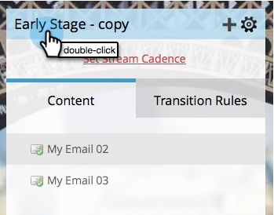
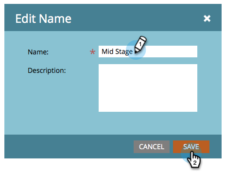

# Renommer un flux {#rename-a-stream}

Si vous souhaitez rester organisé, vous pouvez renommer vos flux.

1. Recherchez et sélectionnez votre programme d’engagement, puis cliquez sur **[!UICONTROL Flux]**.

   

1. Double-cliquez sur le nom du flux actuel.

   

1. Saisissez le nouveau flux **[!UICONTROL Nom]** et cliquez sur **[!UICONTROL Enregistrer]**.

   
