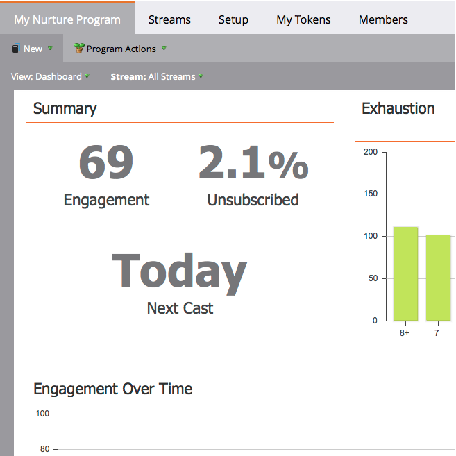
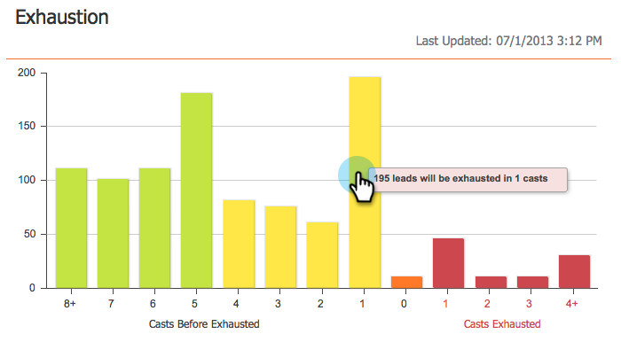
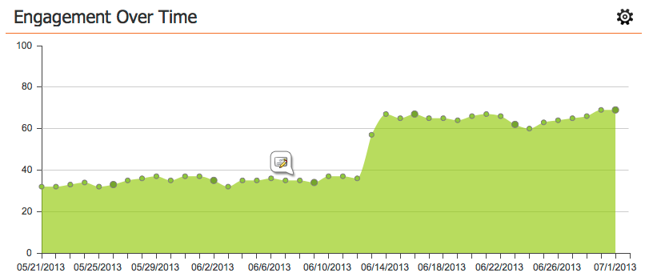
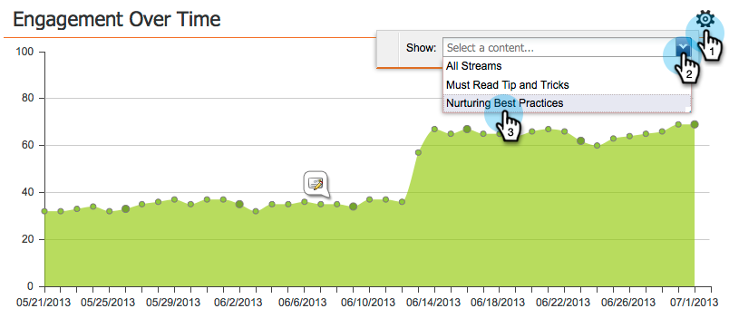
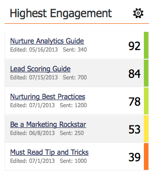
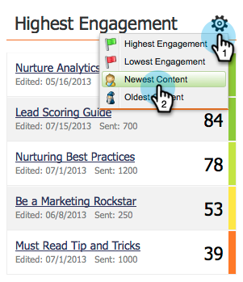

# Le tableau de bord d’engagement {#the-engagement-dashboard}

Le tableau de bord de l’engagement est le moyen le plus simple de voir les performances du contenu de votre programme d’engagement.

>[!NOTE]
>
>Le score d’engagement inclut les données de vos trois derniers lancements. Une nouvelle est calculée 72 heures après chaque plâtre. En savoir plus sur le [&#x200B; score d’engagement &#x200B;](/help/marketo/product-docs/email-marketing/drip-nurturing/reports-and-notifications/understanding-the-engagement-score.md).

## Afficher le tableau de bord de l’engagement {#view-the-engagement-dashboard}

Sélectionnez votre programme d’engagement et cliquez sur **Afficher** > **[!UICONTROL Tableau de bord]**.

>[!TIP]
>
>Consultez le [rapport de performance du flux d’engagement](/help/marketo/product-docs/email-marketing/drip-nurturing/reports-and-notifications/engagement-stream-performance-report.md) pour obtenir des statistiques plus détaillées.

## Présentation du widget d’épuisement {#understand-the-exhaustion-widget}

Ce widget vous permet d’anticiper le moment où les prospects auront épuisé tout le contenu. Le score d&#39;épuisement est calculé immédiatement après chaque cast. L’exemple ci-dessous montre que dans 1 distribution, 195 prospects auront épuisé tout le contenu.

>[!NOTE]
>
>Vous devez accéder à l’onglet [!UICONTROL Configuration] et vérifier que les [!UICONTROL Notifications de contenu épuisées] sont **[!UICONTROL Activées]** pour voir le graphique ci-dessus. S’ils sont désactivés, le graphique sera différent.

>[!CAUTION]
>
>Les personnes qui sont « épuisées » ne recevront aucune communication dans le prochain cast.

## Présentation du widget Engagement au fil du temps {#understand-the-engagement-over-time-widget}

Affiche le score d’engagement moyen au fil du temps et l’impact des modifications de contenu.

>[!AVAILABILITY]
>
>Cette fonctionnalité est disponible sous forme de module complémentaire pour les clients qui utilisent l’explorateur du cycle du chiffre d’affaires de Marketo. Pour plus d’informations, contactez l’équipe du compte Adobe (votre gestionnaire de compte).

Pour afficher un seul élément de contenu au lieu d’une moyenne, cliquez sur l’icône en forme d’engrenage, puis sélectionnez l’élément de contenu.

## Comprendre le widget d’engagement le plus élevé {#understand-the-highest-engagement-widget}

Une liste de tout le contenu, triée par le score d’engagement le plus élevé.

Pour modifier le tri, cliquez sur l’icône d’engrenage, puis sélectionnez l’ordre de tri.

_La plus récente_ et _La plus ancienne_ sont basées sur l’heure de la dernière approbation.

>[!NOTE]
>
>Pour en savoir plus, consultez la section [Créer un programme d’engagement](/help/marketo/product-docs/email-marketing/drip-nurturing/creating-an-engagement-program/create-an-engagement-program.md).
