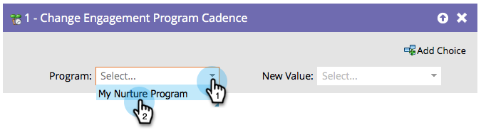
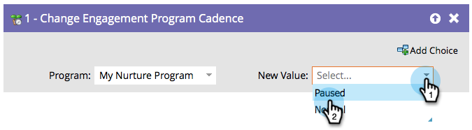

# Suspendre des personnes dans un programme d’engagement {#pause-people-in-an-engagement-program}

Lorsqu’une personne est membre d’un programme d’engagement, elle reçoit le contenu jusqu’à ce qu’elle ait [épuisé tout le contenu](people-who-have-exhausted-content.md). Vous pouvez utiliser l’étape de flux [[!UICONTROL &#x200B; Modifier le rythme du programme d’engagement &#x200B;]](/help/marketo/product-docs/core-marketo-concepts/smart-campaigns/program-flow-actions/change-engagement-program-cadence.md) pour empêcher des personnes de recevoir du contenu même si elles n’ont pas encore épuisé leur contenu.

1. Sélectionnez le programme d’engagement.

   

1. Sélectionnez **[!UICONTROL En pause]** comme **[!UICONTROL Nouvelle valeur]** pour empêcher la personne de recevoir du contenu.

   

   Vous pouvez redéfinir la personne sur **[!UICONTROL Normal]** si vous souhaitez qu’elle recommence à recevoir du contenu. Ils reprendront là où ils s&#39;étaient arrêtés.

   >[!NOTE]
   >
   >Mettre une personne en pause l’empêchera de recevoir du contenu, mais elle passera toujours d’un flux à l’autre si elle répond aux critères.
