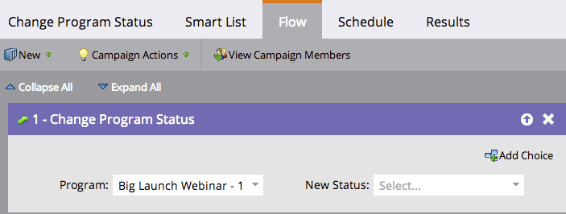
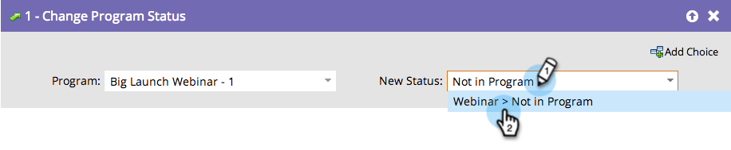

# Supprimer un membre d’un programme d’engagement {#remove-a-member-from-an-engagement-program}

Vous pouvez supprimer des membres d’un programme d’engagement à l’aide de l’étape de flux **[!UICONTROL Modifier le statut du programme]**.

>[!TIP]
>
>Ne l’utilisez pas pour suspendre le contenu pour une personne. Cela éliminera toute attribution dans les analyses. En savoir plus sur la [mise en pause de personnes dans un programme d’engagement](/help/marketo/product-docs/email-marketing/drip-nurturing/using-engagement-programs/pause-people-in-an-engagement-program.md).

## Étape de flux {#flow-step}

1. Faites glisser l’étape de flux **[!UICONTROL Modifier le statut du programme]**.

   

   Sélectionnez le statut, **[!UICONTROL Pas dans le programme]**.

   

   Tous les membres que vous avez définis dans la [liste dynamique](/help/marketo/product-docs/core-marketo-concepts/smart-lists-and-static-lists/creating-a-smart-list/create-a-smart-list.md) ne feront plus partie de ce programme d’engagement.

## Suspendre les personnes  {#pause-people}

Parfois, vous souhaitez suspendre des personnes dans un programme d’engagement et ne pas les supprimer. Cela s’effectue avec le **[!UICONTROL changement de cadence du programme d’engagement]**.

>[!MORELIKETHIS]
>
>[Mettre en pause des personnes dans un programme d’engagement](/help/marketo/product-docs/email-marketing/drip-nurturing/using-engagement-programs/pause-people-in-an-engagement-program.md)
