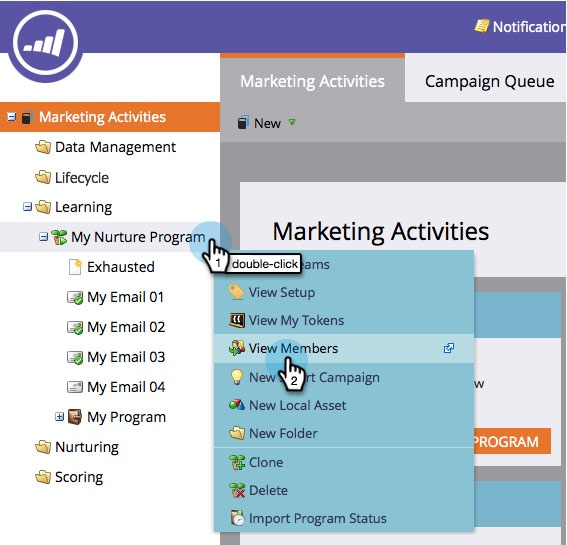
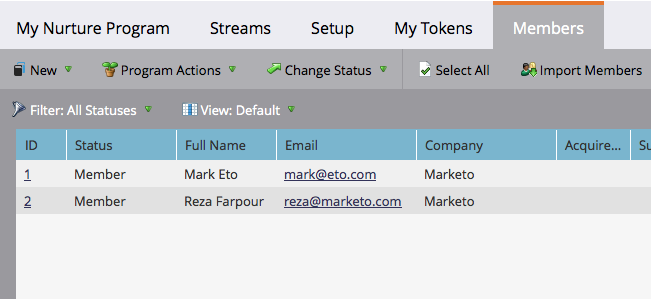

# Afficher les membres d’un programme d’engagement {#see-members-of-an-engagement-program}

Vous pouvez rapidement voir les membres d’un programme d’engagement. Voici comment faire.

1. Dans votre programme d’engagement, cliquez avec le bouton droit et sélectionnez **[!UICONTROL Afficher les membres]**.

   

   >[!NOTE]
   >
   >La valeur de la colonne [Exhausted Content](/help/marketo/product-docs/email-marketing/drip-nurturing/creating-an-engagement-program/understanding-engagement-programs.md) est mise à jour après chaque conversion.

1. Vous pouvez maintenant voir tous les membres de votre programme.

   
