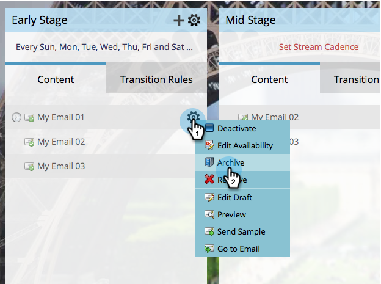
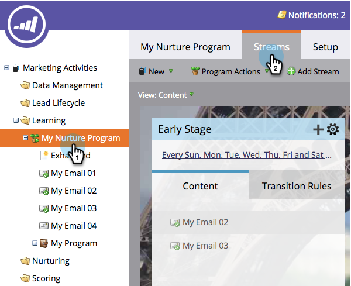
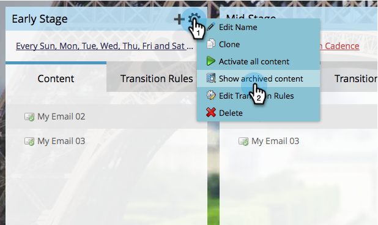
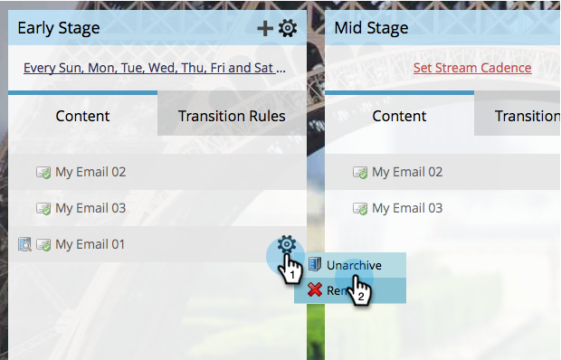

# Archiver et désarchiver le contenu d’un flux {#archive-and-unarchive-stream-content}

Si vous ne souhaitez plus utiliser un élément de contenu dans un flux, vous pouvez le [supprimer](/help/marketo/product-docs/email-marketing/drip-nurturing/using-stream-content/remove-stream-content.md) ou l’archiver. Voici comment archiver du contenu.

>[!TIP]
>
>La suppression détruit tout l’historique associé ; l’archivage le conserve.

## Archiver le contenu du flux {#archive-stream-content}

1. Sélectionnez votre programme d’engagement et accédez à l’onglet **[!UICONTROL Flux]**.

   

1. Pointez sur l’e-mail à archiver, puis sous l’icône en forme d’engrenage, cliquez sur **[!UICONTROL Archiver]**.

   

   Archivez si vous souhaitez conserver l’historique.

## Désarchiver le contenu du flux {#unarchive-stream-content}

1. Sélectionnez votre programme d’engagement et accédez à l’onglet **[!UICONTROL Flux]**.

   

1. Cliquez sur l’icône d’engrenage de votre flux, puis cliquez sur **[!UICONTROL Afficher le contenu archivé]**.

   

1. Maintenant que le contenu archivé s’affiche, cliquez sur l’icône en forme d’engrenage pour le contenu à désarchiver, puis cliquez sur **[!UICONTROL Désarchiver]**.

   

   Désormais, ce contenu peut être hiérarchisé et activé.
