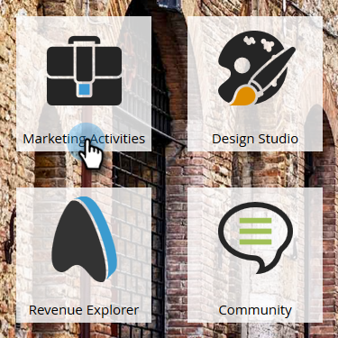

# Prioriser le contenu en flux {#prioritize-stream-content}

Après avoir ajouté du contenu à votre flux, vous pouvez modifier la priorité. Le contenu est toujours diffusé du haut vers le bas dans chaque cast, et aucun contenu n’est envoyé deux fois à la même personne.

1. Accédez à **[!UICONTROL Activités marketing]**.

   

1. Sélectionnez votre programme d’engagement et cliquez sur l’onglet **[!UICONTROL Flux]**.

   

1. Effectuez un glisser-déposer du contenu dans l’ordre souhaité.

   

   >[!NOTE]
   >
   >La priorité sera toujours lue de haut en bas au moment du cast.

