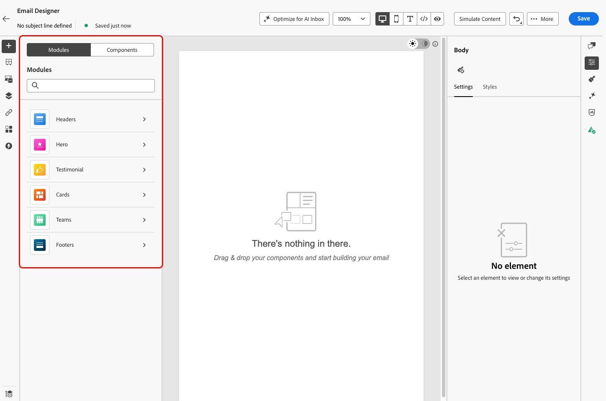
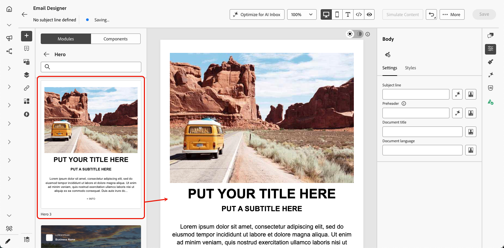
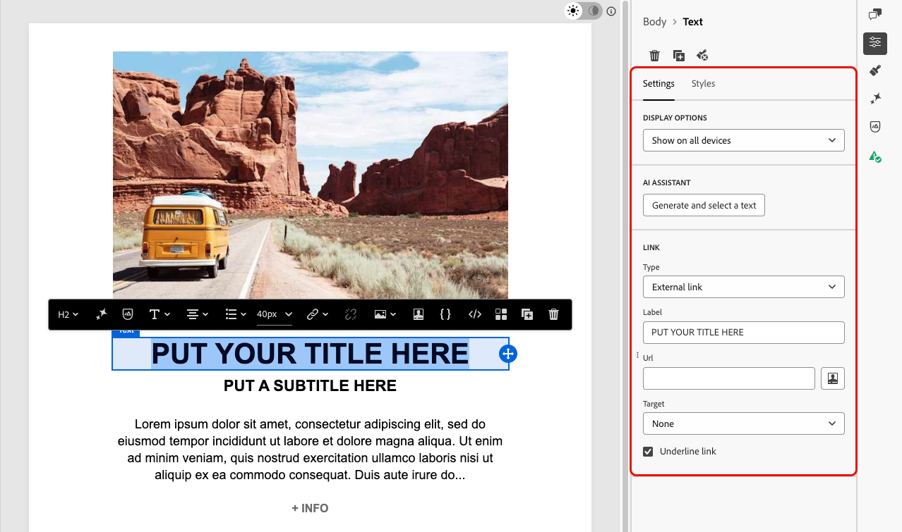
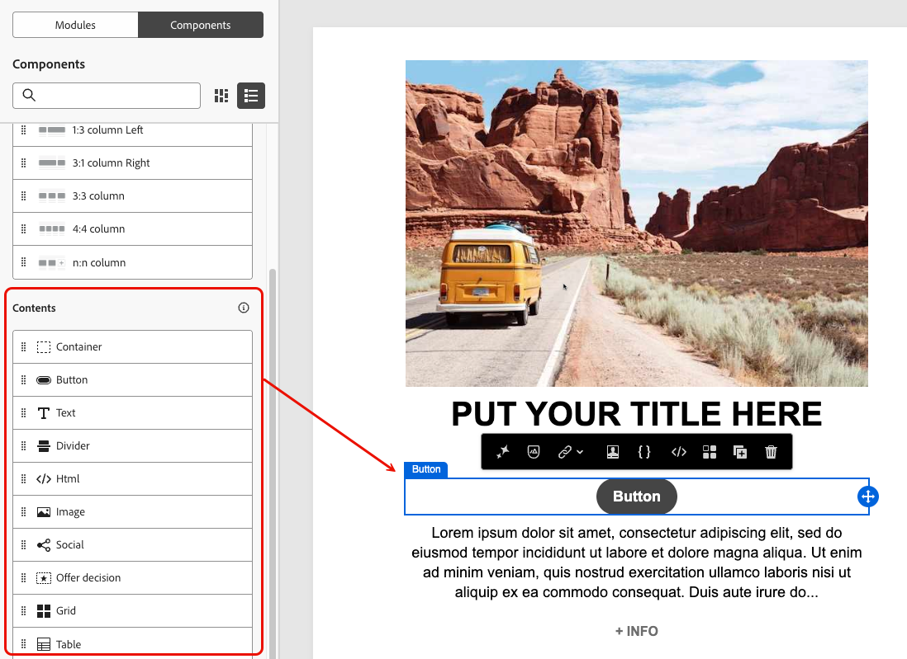

# Utiliser les modules dans le concepteur d’e-mail {#email-modules}

Email Designer comprend une bibliothèque de modules : des blocs de contenu entièrement structurés, prêts à l’emploi, conçus pour accélérer l’assemblage des e-mails et promouvoir la cohérence de la conception dans l’ensemble de vos communications.

Contrairement aux [composants de contenu](/help/marketo/product-docs/email-marketing/email-designer/email-authoring.md#add-structure-and-content), qui sont des espaces réservés vides que vous configurez de A à Z, les modules sont des sections préconfigurées (comme un en-tête de marque, une grille de carte de produit ou un pied de page avec des liens d’opt-out) que vous déposez directement sur votre zone de travail et personnalisez à partir de là.

>[!NOTE]
>
>Les modules ne sont pas des fragments. Ils existent dans l’e-mail que vous concevez. Cependant, après avoir personnalisé un module selon vos besoins, vous pouvez l’enregistrer en tant que [fragment visuel](/help/marketo/product-docs/email-marketing/email-designer/fragments.md#visual-fragments) pour le réutiliser dans d’autres e-mails et messages.

## Accès aux modules et insertion {#access-modules}

Pour afficher et utiliser les modules disponibles dans le Concepteur d’e-mail, procédez comme suit.

1. Ouvrez l’e-mail souhaité.

1. Dans le volet de gauche, cliquez sur l’onglet **[!UICONTROL Modules]**.

   

1. Parcourez les catégories de modules disponibles ou utilisez la barre de recherche pour filtrer par nom.

1. Cliquez sur la flèche **>** en regard d’une catégorie pour la développer et afficher les variantes de mise en page disponibles.

1. Recherchez la variante de module que vous voulez utiliser, puis faites-la glisser directement sur la zone de travail de l’e-mail.

   

1. Le module est inséré avec son contenu par défaut. Cliquez sur n’importe quel élément de la zone de travail pour modifier le contenu en ligne. Cliquez sur une zone de texte pour saisir du texte directement ou cliquez sur une image pour la remplacer à partir de votre bibliothèque de ressources.

   >[!NOTE]
   >
   >Lorsque les thèmes d’e-mail sont appliqués à votre contenu, les modules héritent automatiquement des styles de thème appliqués, assurant ainsi la cohérence de la marque dans votre conception.

1. Utilisez les onglets **[!UICONTROL Paramètres]** et **[!UICONTROL Styles]** dans le volet de droite pour ajuster les propriétés et le style, comme pour tout autre élément d’e-mail.

   {width="70%"}

1. Vous pouvez également ajouter des [composants de contenu](/help/marketo/product-docs/email-marketing/email-designer/email-authoring.md#add-structure-and-content) directement dans le module. Passez à l’onglet **[!UICONTROL Composants]** dans le volet de gauche, puis faites glisser et déposez un composant dans le module. Le composant hérite par défaut du style du module, mais vous pouvez le remplacer si nécessaire.

   {width="60%"}

## Modules disponibles {#available-modules}

Les catégories de modules suivantes sont prêtes à l’emploi. Il existe plusieurs variantes de disposition pour chaque module ; par exemple, des grilles à une, deux ou trois colonnes. Développez les catégories de module pour sélectionner la variante adaptée à votre mise en page.

| Module | Description |
|---|---|
| **[!UICONTROL En-têtes]** | En-tête d’e-mail comportant la marque avec votre logo, des liens de navigation et un texte d’introduction. |
| **[!UICONTROL Bannière]** | Section de bannière pleine largeur : idéale pour les promotions, les annonces ou les ouvertures de campagne. |
| **[!UICONTROL Témoignages]** | Citations de clients et de clientes ou preuves sociales dans un format cohérent et stylisé. |
| **[!UICONTROL Cartes]** | Produits, articles ou éléments de contenu dans des mises en page sous forme de grille à une ou plusieurs colonnes. |
| **[!UICONTROL Équipes]** | Membres de l’équipe, auteurs ou intervenants avec une photo, un nom et un poste. |
| **[!UICONTROL Pieds de page]** | Pied de page complet de l’e-mail avec des liens de navigation, les icônes de réseaux sociaux, les mentions légales et les liens d’opt-out et de page miroir obligatoires. |
