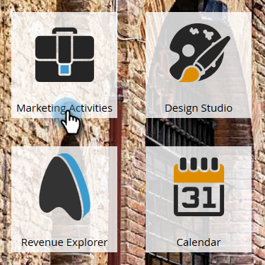
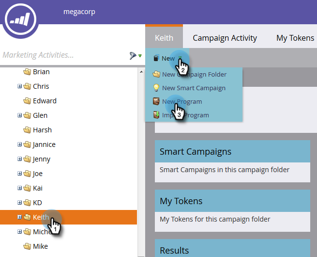
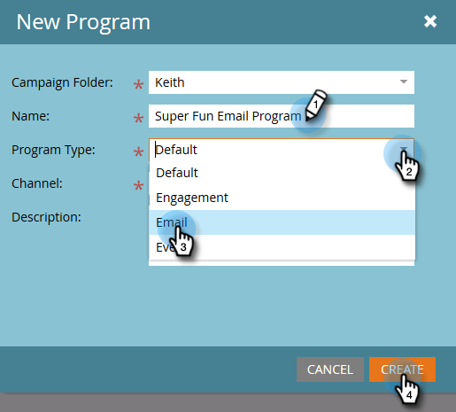
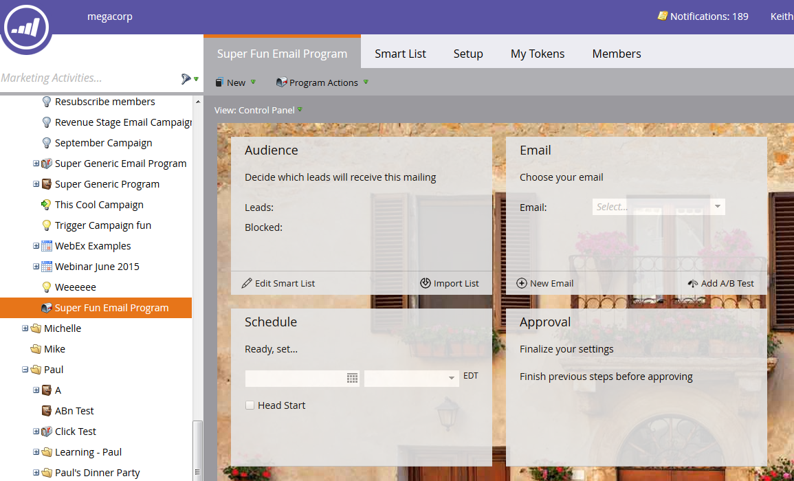

# Créer un programme d’e-mail {#create-an-email-program}

Utilisez des programmes de messagerie pour envoyer rapidement et facilement un e-mail à un groupe de personnes.

1. Accédez à **[!UICONTROL Activités marketing]**.

   

1. Sélectionnez le dossier dans lequel vous souhaitez créer le programme, cliquez sur le menu déroulant **[!UICONTROL Nouveau]**, puis sélectionnez **[!UICONTROL Nouveau programme]**.

   

1. Saisissez un Nom, sélectionnez **[!UICONTROL E-mail]** comme [!UICONTROL Type de programme], puis cliquez sur **[!UICONTROL Créer]**.

   

   >[!NOTE]
   >
   >Lorsque vous sélectionnez **[!UICONTROL E-mail]** comme type de programme, le canal est automatiquement défini sur **[!UICONTROL Envoi d’e-mail]**. Vous pouvez le modifier si vous le souhaitez.

   

Joli ! Notez que le programme se trouve maintenant dans l’arborescence et est prêt à être utilisé. L’étape suivante consiste à définir votre audience. Consultez les articles liés à Marketo ci-dessous.

>[!MORELIKETHIS]
>
>* [Définir une audience avec une liste dynamique](/help/marketo/product-docs/email-marketing/email-programs/managing-people-in-email-programs/define-an-audience-with-a-smart-list.md)
>* [Définir une audience en important une liste](/help/marketo/product-docs/email-marketing/email-programs/managing-people-in-email-programs/define-an-audience-by-importing-a-list.md)
