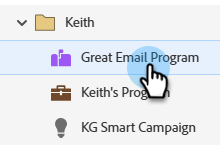
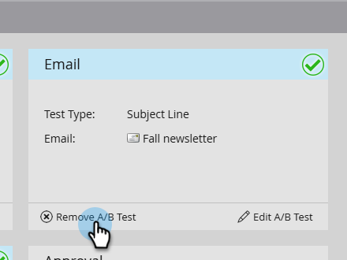

# Annuler le test A/B {#cancel-the-a-b-test}

Si vous avez [ajouté un test A/B](/help/marketo/product-docs/email-marketing/email-programs/email-program-actions/email-test-a-b-test/add-an-a-b-test.md) à votre programme d’e-mail et que vous avez décidé de ne plus le vouloir, il est facile de l’annuler. Voici comment faire.

1. Accédez à **[!UICONTROL Activités marketing]**.

   

1. Sélectionnez votre programme de messagerie.

   

1. Sous la mosaïque **[!UICONTROL E-mail]**, cliquez sur **[!UICONTROL Supprimer le test A/B]**.

   

   >[!NOTE]
   >
   >L’approbation de votre programme de messagerie doit être annulée pour que vous puissiez supprimer le test A/B. Pour plus d’informations, voir [Approuver/annuler l’approbation d’un programme de messagerie](/help/marketo/product-docs/email-marketing/email-programs/email-program-actions/approve-unapprove-an-email-program.md).
