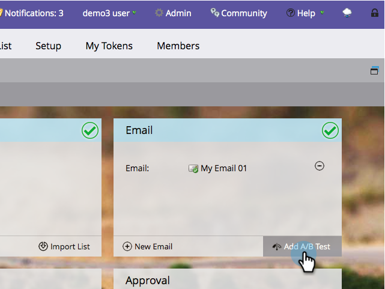
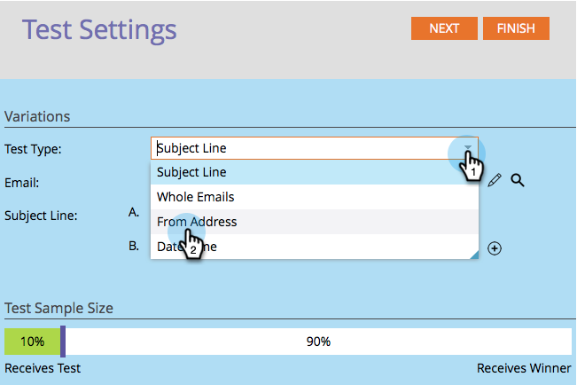
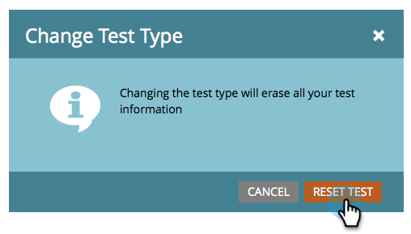
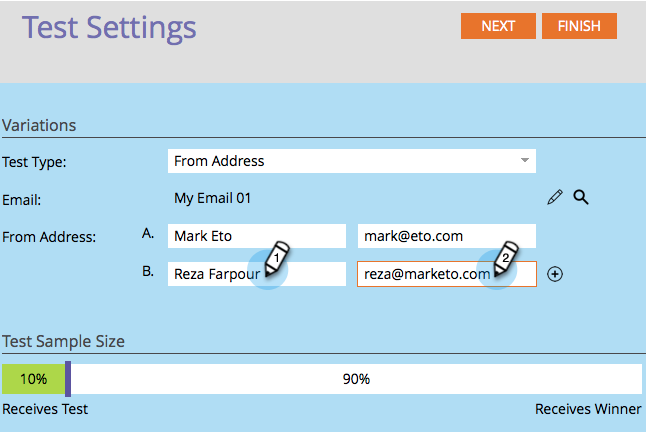
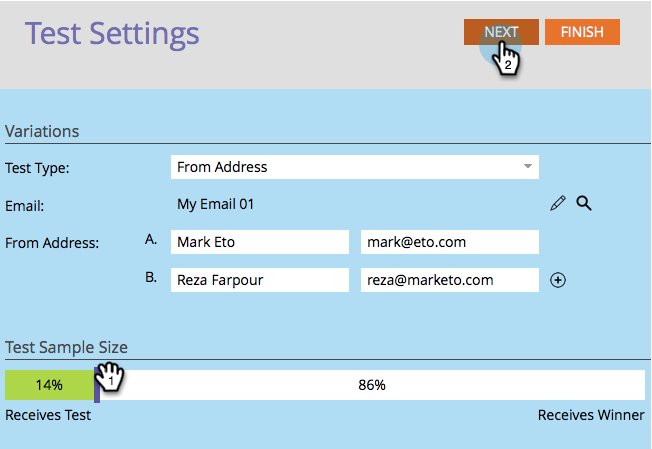

# Utiliser Le Test A/B « [!UICONTROL Adresse De L’Expéditeur] » {#use-from-address-a-b-testing}

Vous pouvez facilement tester A/B vos e-mails. Un test intéressant est le test **[!UICONTROL Adresse d’origine]**. Voici comment le configurer.

>[!PREREQUISITES]
>
>[Ajouter un test A/B](/help/marketo/product-docs/email-marketing/email-programs/email-program-actions/email-test-a-b-test/add-an-a-b-test.md)

1. Sous la mosaïque **[!UICONTROL E-mail]**, une fois votre e-mail sélectionné, cliquez sur **[!UICONTROL Ajouter un test A/B]**.

   

1. Une nouvelle fenêtre s’ouvre. Sélectionnez **[!UICONTROL Adresse de l’expéditeur]** pour **[!UICONTROL Type de test]**.

   

1. Si vous disposez d’informations de test précédentes (comme un test du sujet), vous pouvez cliquer en toute sécurité sur **[!UICONTROL Réinitialiser le test]**.

   

1. Saisissez la deuxième information **[!UICONTROL Adresse de l&#39;expéditeur]** que vous souhaitez tester.

   >[!NOTE]
   >
   >L’option A sera préremplie avec les informations contenues dans l’e-mail sélectionné.

   

   >[!TIP]
   >
   >Vous pouvez cliquer sur le **+** pour ajouter autant d&#39;adresses d&#39;expédition que vous le souhaitez.

1. Utilisez le curseur pour choisir le pourcentage d’audience souhaité dans votre test A/B, puis cliquez sur **[!UICONTROL Suivant]**.

   

   >[!NOTE]
   >
   >Les différentes variations sont envoyées à des parties égales de la taille d’échantillon de test choisie.

   >[!CAUTION]
   >
   >**Nous vous recommandons d’éviter de définir la taille de l’échantillon sur 100 %**. Si vous utilisez une liste statique, la définition de la taille de l’échantillon sur 100 % envoie l’e-mail à tous les membres de l’audience et le gagnant n’est attribué à personne. Si vous utilisez une liste **intelligente**, la définition de la taille de l’échantillon sur 100 % envoie l’e-mail à toutes les personnes de l’audience _à ce moment-là_. Lorsque le programme de messagerie s’exécutera à nouveau à une date ultérieure, toutes les nouvelles personnes qui remplissent les critères de la liste dynamique recevront également le message électronique, car elles sont désormais incluses dans l’audience.

   OK, on y est presque. Maintenant, nous devons [définir les critères de gagnant du test A/B](/help/marketo/product-docs/email-marketing/email-programs/email-program-actions/email-test-a-b-test/define-the-a-b-test-winner-criteria.md).
