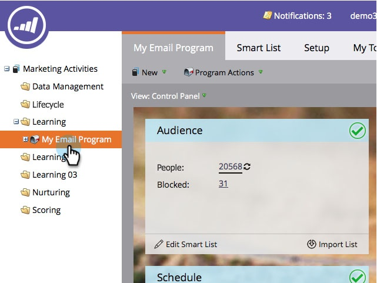
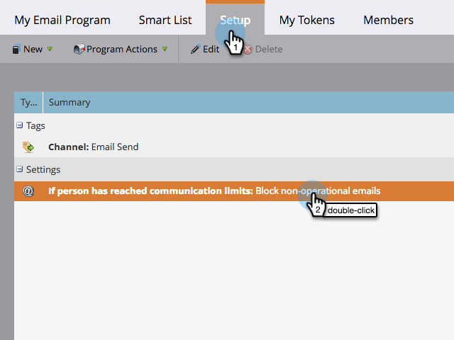

# Activer/désactiver les limites de communication dans un programme d’e-mail {#enable-disable-communication-limits-in-an-email-program}

Lors de l’exécution d’un programme de messagerie, vous pouvez choisir d’ignorer ou de respecter les [ limites de communication au niveau administrateur ](/help/marketo/product-docs/administration/email-setup/enable-communication-limits.md). Voici comment procéder.

>[!NOTE]
>
>Les limites de communication sont [définies dans la section Admin](/help/marketo/product-docs/administration/email-setup/enable-communication-limits.md) et vous permettent d’éviter d’envoyer un trop grand nombre d’e-mails à une seule personne.

1. Accédez à **[!UICONTROL Activités marketing]**.

   

1. Recherchez et sélectionnez votre programme de messagerie.

   

1. Sous l’onglet **[!UICONTROL Configuration]**, double-cliquez sur l’élément de ligne de limite de communication.

   

1. Par défaut, les e-mails non opérationnels sont bloqués si les limites de communication sont atteintes, mais si vous souhaitez les contourner, décochez la case et cliquez sur **[!UICONTROL Enregistrer]**.

   

   Si vous cochez la case **[!UICONTROL Bloquer les e-mails non opérationnels]**, l’e-mail ne sera pas envoyé à toute personne ayant reçu plus d’e-mails que ne l’autorisent vos paramètres d’administration.
