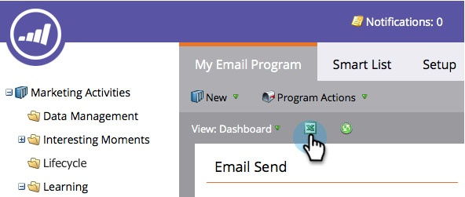

# Exporter le tableau de bord du programme d’e-mail vers Excel {#export-email-program-dashboard-to-excel}

Une fois que vous avez exécuté un programme de messagerie et que vous disposez de données dans le tableau de bord, vous pouvez exporter ces données brutes vers Excel pour une analyse plus approfondie. Voici comment faire.

1. Accédez à **[!UICONTROL Activités marketing]**.

   

1. Recherchez et sélectionnez votre programme de messagerie.

   

   >[!NOTE]
   >
   >Si votre programme de messagerie n’a pas encore démarré, vous ne verrez pas de tableau de bord, car il n’y a aucune donnée à afficher.

1. Il vous suffit de cliquer sur l’icône Excel pour lancer l’exportation.

   

   Plutôt facile, non ?
