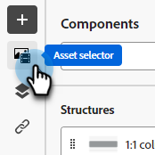

# Document temporaire {#temp-doc}

## Copier sous cette partie {#copy}

### Ajout d’Assets {#add-assets}

Ajoutez les images stockées dans la section [Images et fichiers](/help/marketo/product-docs/demand-generation/images-and-files/add-images-and-files-to-marketo.md){target="_blank"} de votre instance Marketo Engage.

>[!NOTE]
>
>Vous pouvez uniquement ajouter des images dans le nouveau concepteur, mais aucun autre type de fichier pour le moment.

1. Pour accéder à vos images, cliquez sur l’icône Sélecteur de ressources .

   

1. Faites glisser et déposez l’image souhaitée dans un composant de structure.

   CAPTURE D’ÉCRAN

   >[!NOTE]
   >
   >Pour remplacer une image existante, sélectionnez-la, puis cliquez sur **Sélectionner une ressource** dans l’onglet Paramètres à droite.

Cliquez sur Activer le contenu conditionnel pour ajouter du contenu dynamique et adapter le contenu aux profils ciblés selon des règles conditionnelles.

Si nécessaire, vous pouvez personnaliser davantage votre e-mail en cliquant sur Basculer vers l’éditeur de code dans le menu avancé. Vous pouvez ainsi modifier le code source de l’e-mail, par exemple pour ajouter des balises HTML de suivi ou personnalisées.

ATTENTION
Vous ne pouvez pas revenir au concepteur visuel de cet e-mail après avoir basculé vers l’éditeur de code.

Une fois que votre contenu est prêt, cliquez sur le bouton Simuler du contenu pour vérifier le rendu. Vous pouvez choisir la vue bureau ou la vue mobile.

Une fois prêt, cliquez sur Enregistrer
