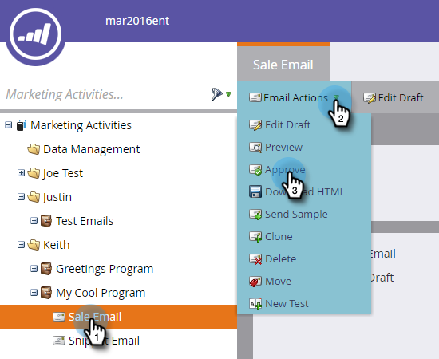
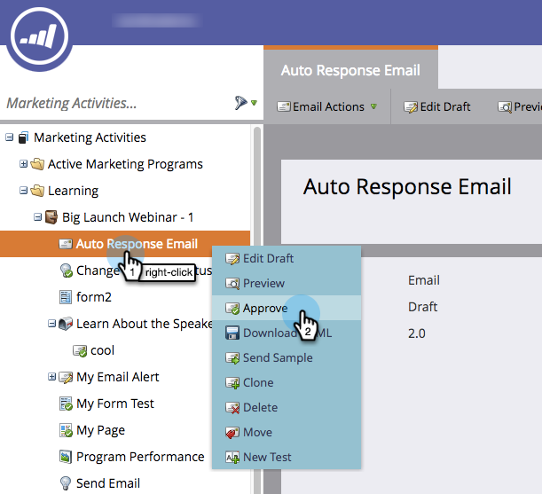
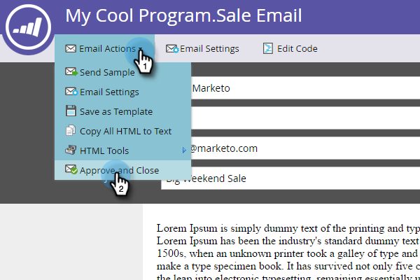

# Approuver un e-mail {#approve-an-email}

Les e-mails commencent à l’état de brouillon. Ils ne sont généralement pas disponibles dans le système tant que vous ne les avez pas approuvés. Il existe plusieurs façons d’approuver un e-mail.

## Validez-la à l’aide du menu [!UICONTROL Actions d’e-mail] {#approve-it-using-the-email-actions-menu}

1. Recherchez et sélectionnez votre e-mail, cliquez sur le menu déroulant **[!UICONTROL Actions d’e-mail]** et sélectionnez **[!UICONTROL Approuver]**.

   

## L&#39;approuver directement dans l&#39;arborescence {#approve-it-directly-in-the-tree}

1. Recherchez et sélectionnez votre e-mail, cliquez dessus avec le bouton droit et sélectionnez **[!UICONTROL Approuver]**.

   

## Approuver l’e-mail dans l’éditeur d’e-mail {#approve-your-email-in-the-email-editor}

1. Dans votre e-mail, cliquez sur le menu déroulant **[!UICONTROL Actions d’e-mail]** et sélectionnez **[!UICONTROL Approuver et fermer]**.

   

Une fois votre e-mail validé, il est prêt à l’emploi.
