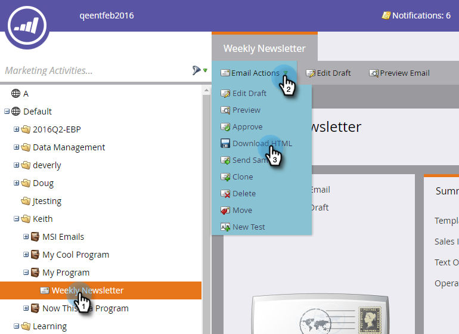

# Télécharger la version HTML d’un e-mail {#download-an-emails-html}

À des fins de sauvegarde ou autres, Marketo vous permet de télécharger le contenu HTML d’un e-mail.

1. Recherchez l’e-mail et sélectionnez-le. Dans la liste déroulante **[!UICONTROL Actions d’e-mail]**, cliquez sur **[!UICONTROL Télécharger HTML]**.

   

C&#39;est aussi simple que ça !
