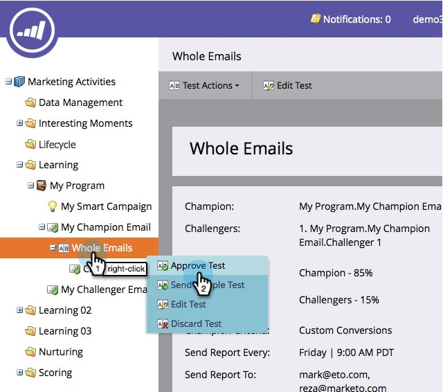

# Champion/Challenger : approuver votre test d’e-mail {#champion-challenger-approve-your-email-test}

Étape finale de la configuration de votre test d’e-mail pour l’approuver. Voici comment faire.

>[!PREREQUISITES]
>
>[Configurer des alertes de rapport](/help/marketo/product-docs/email-marketing/general/functions-in-the-editor/email-tests-champion-challenger/champion-challenger-analytics.md#configure-report-alerts)

1. Accédez à **[!UICONTROL Activités marketing]**.

   

1. Recherchez et cliquez avec le bouton droit sur le **[!UICONTROL Test e-mail]**, puis cliquez sur **[!UICONTROL Approuver le test]**.

   

   >[!NOTE]
   >
   >Lors de la validation d’un test **E-mail complet**, validez d’abord l’e-mail du challenger.

   >[!NOTE]
   >
   >Pour envoyer le test, choisissez l’e-mail auquel vous avez ajouté le test à l’étape de flux **Envoyer un e-mail** de votre campagne de déclenchement. Vous avez également la possibilité d’insérer cet e-mail dans un flux d’un programme d’engagement. Les e-mails Champion/Challenger ne fonctionneront pas dans les campagnes par lots.

   N&#39;était-ce pas facile ? Une fois que vous avez reçu quelques rapports, vous voudrez déclarer un champion.

   >[!MORELIKETHIS]
   >
   >* [Champion/Challenger : Déclarez un champion](/help/marketo/product-docs/email-marketing/general/functions-in-the-editor/email-tests-champion-challenger/champion-challenger-declare-a-champion.md)
   >* [Champion/Challenger : ignorer un test par e-mail](/help/marketo/product-docs/email-marketing/general/functions-in-the-editor/email-tests-champion-challenger/champion-challenger-discard-an-email-test.md)
