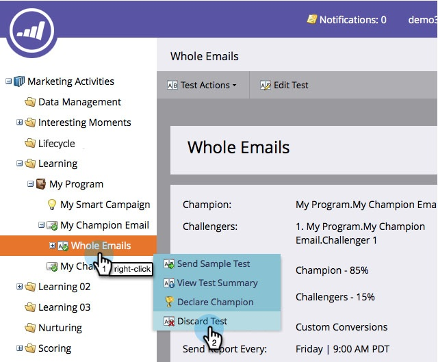
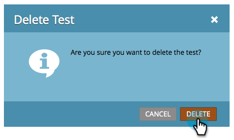

# Champion/Challenger : supprimer un test d’e-mail {#champion-challenger-discard-an-email-test}

Si, à tout moment, vous décidez de ne pas continuer à exécuter votre test d’e-mail, vous pouvez le supprimer. Voici comment faire.

>[!PREREQUISITES]
>
>[Champion/Challenger : Approuvez Votre Test E-Mail](/help/marketo/product-docs/email-marketing/general/functions-in-the-editor/email-tests-champion-challenger/champion-challenger-approve-your-email-test.md)

1. Accédez à **[!UICONTROL Activités marketing]**.

   

1. Recherchez votre test d’e-mail et cliquez avec le bouton droit dessus, puis cliquez sur **[!UICONTROL Ignorer le test]**.

   

1. Cliquez sur **[!UICONTROL Supprimer]** pour confirmer.

   

   Vous avez terminé ! Si vous décidez de configurer à nouveau un test, continuez et [ajoutez un champion/challenger d’e-mail](/help/marketo/product-docs/email-marketing/general/functions-in-the-editor/email-tests-champion-challenger/add-an-email-champion-challenger.md).
