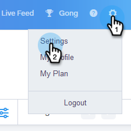
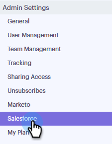
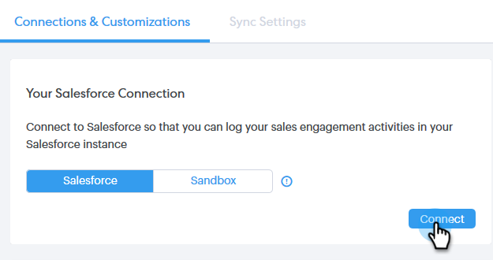
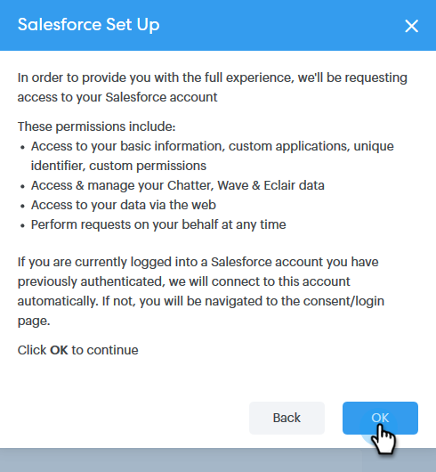
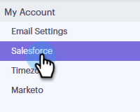
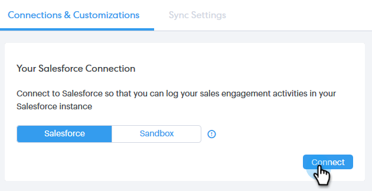

# Connecter votre compte Sales Connect à Salesforce {#connect-your-sales-connect-account-to-salesforce}

Pour connecter [!DNL Sales Connect] à [!DNL Salesforce], procédez comme suit.

## Comment se connecter en tant qu’administrateur {#how-to-connect-as-an-admin}

1. Dans [!DNL Sales Connect], cliquez sur l’icône d’engrenage en haut à droite et sélectionnez **[!UICONTROL Paramètres]**.

   

1. Sous [!UICONTROL  Admin Settings] cliquez sur **[!UICONTROL Salesforce]**.

   

1. Dans l’onglet [!UICONTROL Connexions et personnalisations], cliquez sur **[!UICONTROL Se connecter]**.

   

1. Cliquez sur **[!UICONTROL OK]**.

   

1. Si vous êtes déjà connecté à Salesforce, vous serez connecté. Si ce n’est pas le cas, il vous sera demandé de vous connecter.

## Connexion en tant que non-administrateur {#how-to-connect-as-a-non-admin}

1. Dans [!DNL Sales Connect], cliquez sur l’icône d’engrenage et sélectionnez **[!UICONTROL Paramètres]**.

   

1. Sous [!UICONTROL  Mon compte ], sélectionnez **[!UICONTROL Salesforce]**.

   

1. Dans l’onglet [!UICONTROL Connexions et personnalisations], cliquez sur **[!UICONTROL Se connecter]**.

   

1. Cliquez sur **[!UICONTROL OK]**.

   

1. Si vous êtes déjà connecté à Salesforce, vous serez connecté. Si ce n’est pas le cas, il vous sera demandé de vous connecter.
