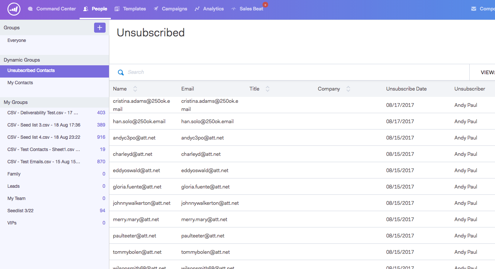
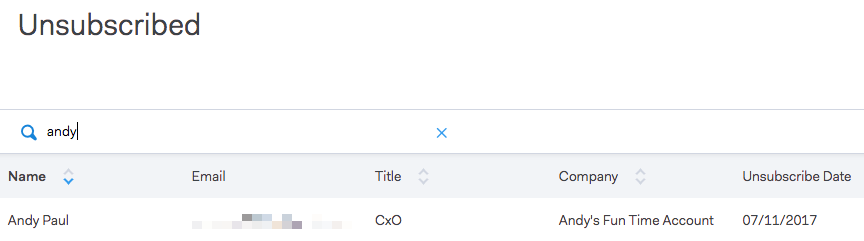
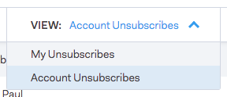

# Groupe de désabonnement {#unsubscribe-group}

Voir et gérer toutes les personnes désabonnées en un seul endroit.

Utilisez la barre de recherche pour rechercher des personnes désabonnées.

Si vous êtes administrateur, vous pouvez accéder au groupe de désabonnements pour effectuer un filtrage par [!UICONTROL Désabonnements du compte] et afficher tous les désabonnements qui ont été collectés dans votre base de données des personnes.

