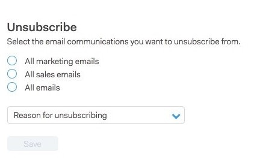

# Page de destination du lien de désabonnement {#unsubscribe-link-landing-page}

Lorsqu’une personne clique sur votre lien de désabonnement, elle est redirigée vers une page de destination de désabonnement où elle peut sélectionner ce dont elle souhaite se désabonner et pourquoi.

Ces informations seront enregistrées dans la vue des détails de la personne pour être affichées ultérieurement.
