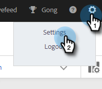
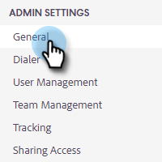
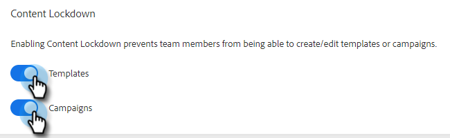

# Verrouillage de contenu {#content-lockdown}

En activant le verrouillage du contenu, empêchez les utilisateurs non-administrateurs de modifier les modèles et/ou les campagnes. Les utilisateurs ne pourront pas : partager, cloner, modifier ou supprimer du contenu. Ils n’auront pas non plus la possibilité d’archiver les modèles.

>[!NOTE]
>
>Les utilisateurs et utilisatrices pourront toujours modifier le contenu d’un e-mail au moment de l’envoi ou du lancement d’une campagne.

1. Cliquez sur l’icône d’engrenage et sélectionnez **[!UICONTROL Paramètres]**.

   

1. Sous [!UICONTROL Paramètres d’administration], cliquez sur **[!UICONTROL Général]**.

   

1. Faites défiler jusqu’à [!UICONTROL Verrouillage du contenu]. L’activation de l’un des curseurs désactive la capacité des membres de votre équipe à créer/modifier des modèles et/ou des campagnes.

   
