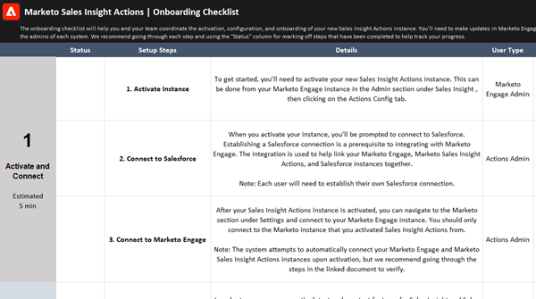

# Liste de contrôle de l’intégration des utilisateurs et des utilisatrices pour Actions des informations sur les ventes {#sales-insight-actions-user-onboarding-checklist}

Si vous recherchez des ressources sur la prise en main des actions Marketo Sales Insight, [téléchargez la liste de contrôle d’intégration](/help/marketo/product-docs/marketo-sales-insight/actions/getting-started/assets/onboarding-checklist-marketo-sales-insight-actions-2023.xlsx).

>[!NOTE]
>
>Marketo Sales Insight Actions est une application web qui s’intègre exclusivement au CRM Salesforce via le package [Marketo Sales Insight](/help/marketo/product-docs/marketo-sales-insight/msi-for-salesforce/installation/install-marketo-sales-insight-package-in-salesforce-appexchange.md){target="_blank"}. Il est parfois appelé « Ventes Marketo » ou simplement « Actions ».

 

La liste de contrôle vous aidera, vous et votre équipe, à coordonner l’activation, la configuration et l’intégration de votre nouvelle instance Sales Insight Actions. Vous devrez effectuer des mises à jour dans les actions Marketo, Salesforce et Marketo Sales Insight pour terminer la configuration. Veillez donc à vous coordonner avec les administrateurs de chaque système.
