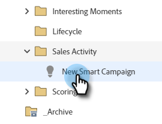
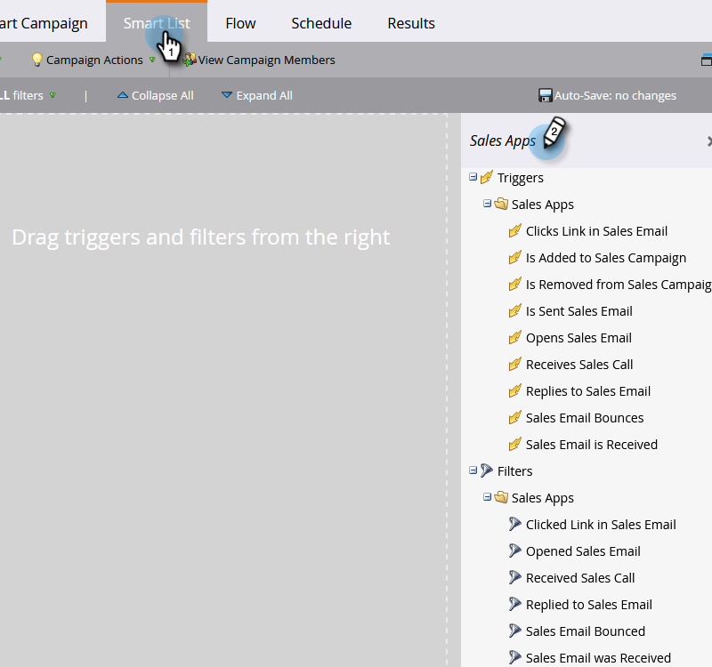
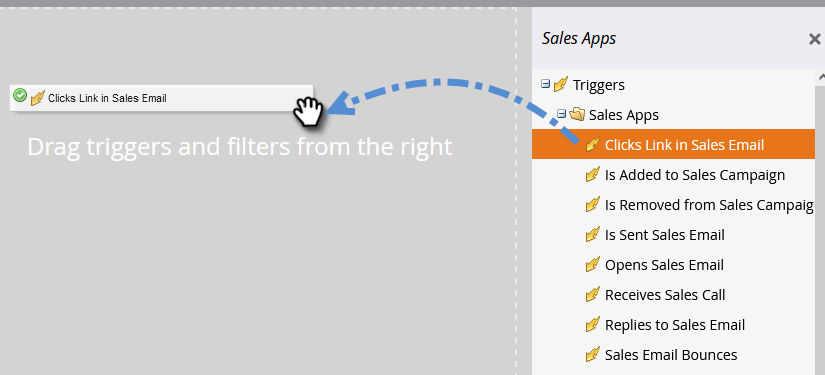

# Déclencheurs et filtres des activités de vente {#sales-activity-triggers-and-filters}

Si vous cherchez à mieux coordonner l&#39;engagement de votre équipe des ventes ou si vous souhaitez avoir une meilleure idée de la façon dont elle interagit avec les clients sur le parcours des acheteurs, les informations sur les activités de vente dans Marketo vous seront utiles.

Suivez les étapes ci-dessous pour savoir comment utiliser les filtres et les déclencheurs d’activité de vente dans vos campagnes intelligentes.

1. Recherchez et sélectionnez la campagne intelligente de votre choix.

   

1. Dans l’onglet **[!UICONTROL Liste dynamique]**, recherchez « [!UICONTROL Applications commerciales] ».

   

1. Sélectionnez et faites glisser sur le filtre ou le déclencheur de votre choix.

   

1. Sélectionnez les contraintes de votre choix.

   

>[!NOTE]
>
>Pour obtenir une liste complète des activités, contraintes et définitions, consultez notre [[!DNL Sales Insight Actions] Glossaire des activités](/help/marketo/product-docs/marketo-sales-insight/actions/marketo/sales-insight-actions-activity-glossary.md).
