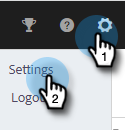
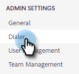
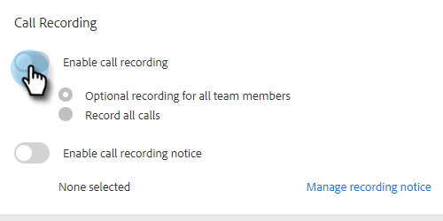
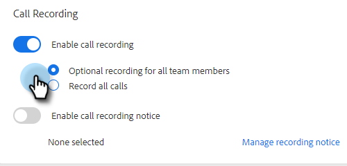

# Activer l’enregistrement des appels {#enable-call-recording}

En tant qu’administrateur, vous pouvez activer l’enregistrement des appels pour vos appels [!DNL Sales Insight Actions]. L&#39;enregistrement des appels de votre équipe peut être un excellent moyen de guider vos représentants commerciaux sur les meilleures pratiques d&#39;appel.

1. Cliquez sur l’icône Paramètres et sélectionnez **[!UICONTROL Paramètres]**.

   

1. Sous [!UICONTROL Admin Settings], cliquez sur **[!UICONTROL Dialer]**.

   

1. Sélectionnez le bouton (bascule) **[!UICONTROL Activer l’enregistrement des appels]**.

   

1. Si vous souhaitez donner à vos vendeurs la possibilité d&#39;activer ou de désactiver l&#39;enregistrement des appels, cliquez sur **[!UICONTROL Enregistrement facultatif pour tous les membres de l&#39;équipe]**. Si vous souhaitez que tous les appels soient enregistrés automatiquement, cliquez sur **[!UICONTROL Enregistrer tous les appels]**.

   

>[!MORELIKETHIS]
>
>[Paramètres De Consentement Bipartite](/help/marketo/product-docs/marketo-sales-insight/actions/phone/two-party-consent-settings.md)
