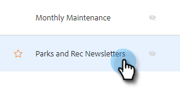
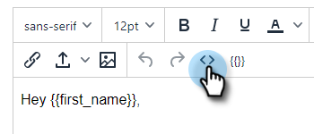

# Utilisation du HTML {#using-html}

1. Copiez le code source de vos e-mails dans l’outil que vous utilisez pour créer des e-mails dans HTML (par exemple, l’éditeur d’e-mail Marketo).

1. Sélectionnez le modèle auquel vous souhaitez ajouter HTML.

   

1. Dans la vignette Éditeur de modèles , cliquez sur **[!UICONTROL Modifier]**.

   

1. Cliquez sur le bouton **&#x200B;**&#x200B;dans votre éditeur de modèles.

   

1. Collez le code source et cliquez sur **[!UICONTROL Enregistrer]**.

   

>[!NOTE]
>
>Si l’erreur « Erreur - Suppression des balises style/java/html » s’affiche, cela signifie que vous avez un style que nous ne prenons pas en charge. Vous devez rechercher le code Source pour le style de mot et tout supprimer de ``.
