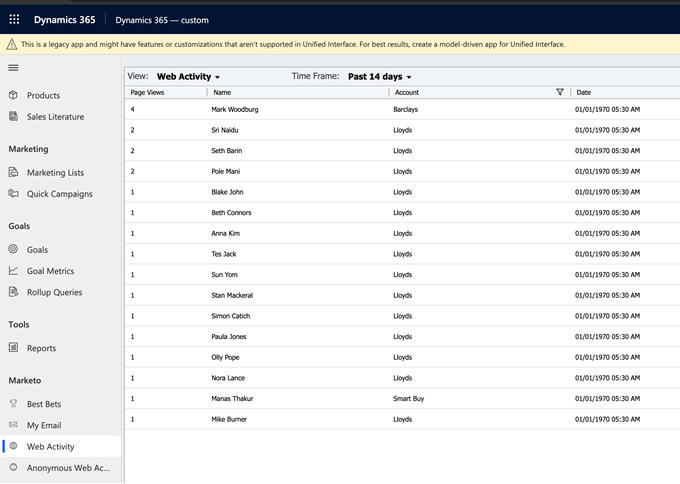

# Activités web {#web-activities}

L’onglet Activités web affiche les activités web de vos leads/contacts.
Examinez les dernières activités web de votre prospect, en citant le nombre de visites de page et les comptes respectifs. Vous pouvez filtrer les résultats pour les limiter à un nombre de pages spécifié.

## Activités Web anonymes {#anonymous-web-activities}

L’onglet Activités web anonymes affiche toutes les activités web **anonymes** des visiteurs de la page web. Examinez les dernières activités web citant le nombre de visites de page.
