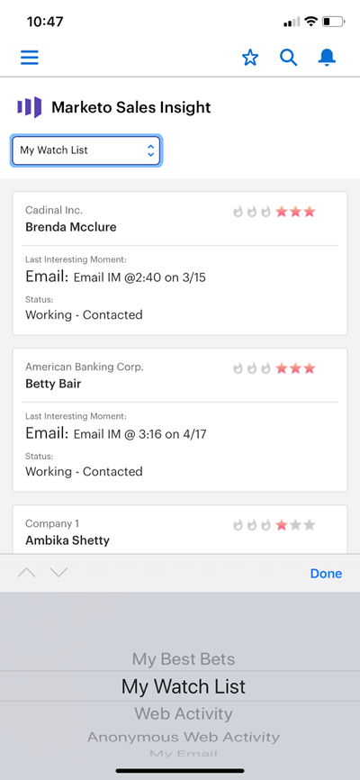

# [!DNL Best Bets] dans [!DNL Salesforce1] {#best-bets-in-salesforce}

Vos [[!DNL Best Bets]](/help/marketo/product-docs/marketo-sales-insight/msi-for-salesforce/features/stars-and-flames/priority-urgency-relative-score-and-best-bets.md) sont vos leads et contacts avec la plus haute urgence et le score relatif le plus élevé. Seuls les prospects que vous détenez sont visibles dans cette liste qui est mise à jour à mesure que les scores des prospects changent.

>[!AVAILABILITY]
>
>Les meilleurs paris ne sont pas disponibles avec la licence Salesforce Platform.

1. Accédez à la zone Marketo de l’application [!DNL Salesforce].

   Dans la liste déroulante, vous pouvez choisir « [!UICONTROL Mes meilleurs résultats] », « [!UICONTROL Ma liste de surveillance] », « [!UICONTROL Activité Web] », « [!UICONTROL Activité Web anonyme] » ou « [!UICONTROL Mon e-mail] ».

   

>[!MORELIKETHIS]
>
>* [Moments significatifs dans [!UICONTROL Salesforce1]](/help/marketo/product-docs/marketo-sales-insight/msi-for-salesforce/msi-for-mobile/interesting-moments-in-salesforce1.md)
>* [Envoyer un e-mail Marketo et des actions de campagne et de watchlist dans [!UICONTROL Salesforce1]](/help/marketo/product-docs/marketo-sales-insight/msi-for-salesforce/msi-for-mobile/send-marketo-email-and-campaign-and-watchlist-actions-in-salesforce1.md)
