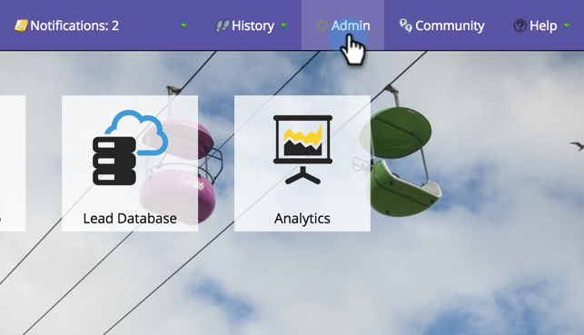
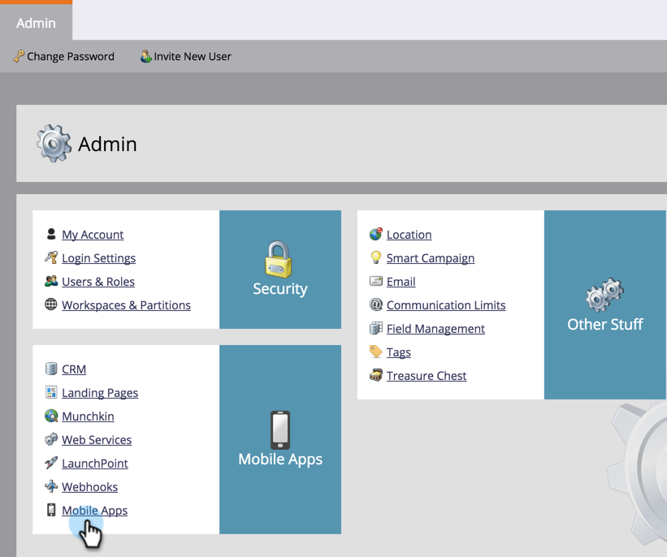
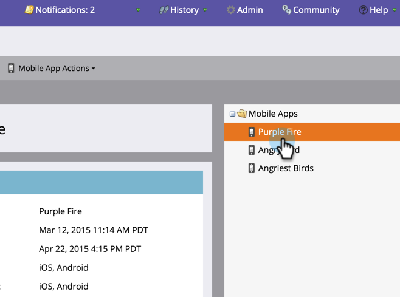
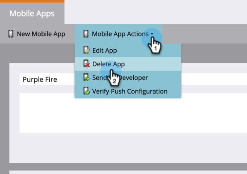
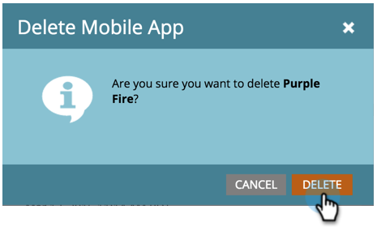

# Supprimer l’application mobile {#delete-mobile-app}

1. Cliquez sur **[!UICONTROL Admin]**.

   

1. Sélectionnez **[!UICONTROL Applications mobiles]**.

   

1. Sélectionnez l’application mobile souhaitée.

   

1. Cliquez sur **[!UICONTROL Actions de l’application mobile]** puis sélectionnez **[!UICONTROL Supprimer l’application]**.

   

1. Confirmez en cliquant sur **[!UICONTROL Supprimer]**.

   

Et voilà ! Les notifications push ne peuvent plus être envoyées à partir de cette application mobile.
