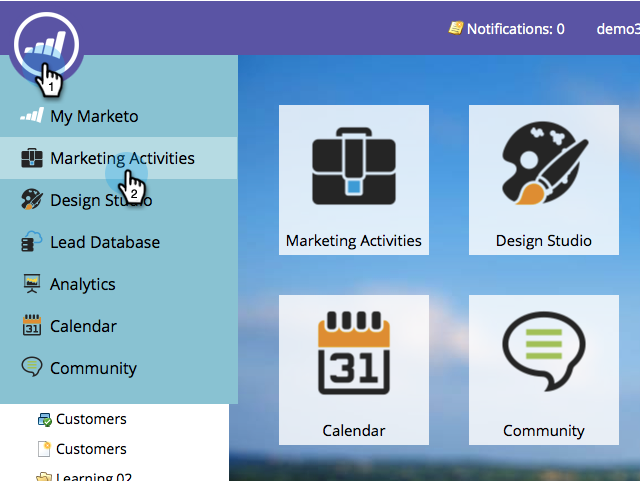
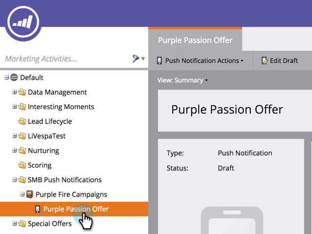
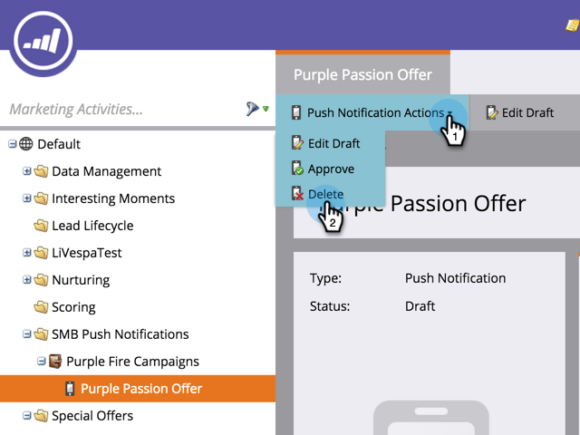

# Supprimer une notification push mobile {#delete-mobile-push-notification}

1. Accédez à la zone **[!UICONTROL Activités marketing]**.

1. Recherchez et sélectionnez votre notification push mobile.

   

1. Sous **[!UICONTROL Actions de notification push]**, cliquez sur **[!UICONTROL Supprimer]**.

   

1. Confirmez en cliquant sur **[!UICONTROL Supprimer]**.

   

   >[!NOTE]
   >
   >Si la notification push mobile est utilisée par d’autres ressources, vous ne serez pas autorisé à la supprimer. Vous devez procéder à une suppression dans les ressources.
