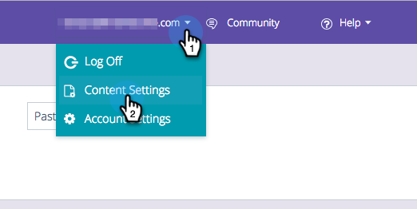
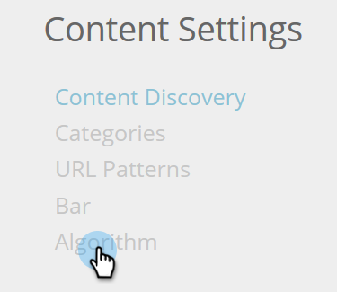
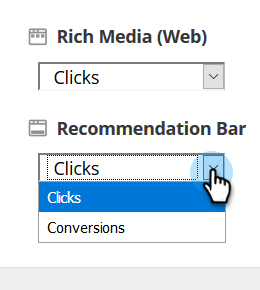

# Paramètres d’objectif d’algorithme {#algorithm-goal-settings}

Les paramètres d’objectif de l’algorithme vous permettent de définir l’objectif final de l’algorithme d’intelligence artificielle Contenu prédictif en fonction des objectifs de votre entreprise.

1. Dans Contenu prédictif, cliquez sur votre nom d’utilisateur et sélectionnez **[!UICONTROL Paramètres de contenu]**.

   

1. Sous Paramètres du contenu, sélectionnez **[!UICONTROL Algorithme]**.

   

1. Sélectionnez un objectif pour chaque source de contenu prédictif pour l’algorithme d’IA afin d’optimiser les performances de votre contenu.

   

   | **[!UICONTROL Clics]** | Afficher le contenu le plus susceptible d’inciter la personne qui le consulte à cliquer dessus |
   |---|---|
   | **[!UICONTROL Conversions]** | Afficher le contenu le plus susceptible d’inciter la personne qui le consulte à envoyer un formulaire |

1. Cliquez sur **[!UICONTROL Enregistrer]** lorsque vous avez terminé.

   
