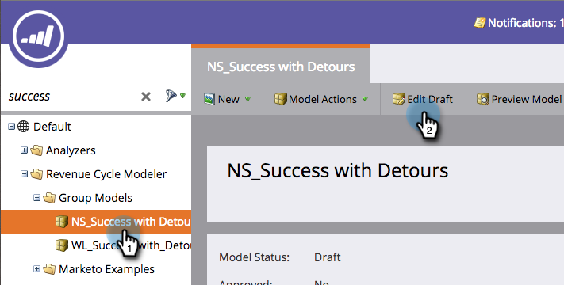
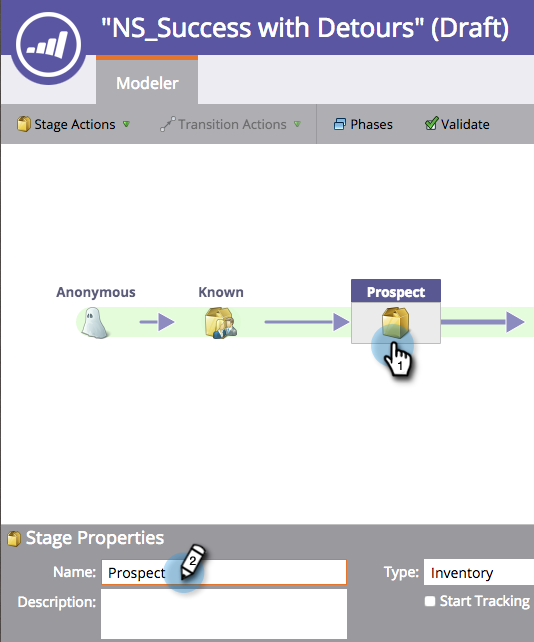
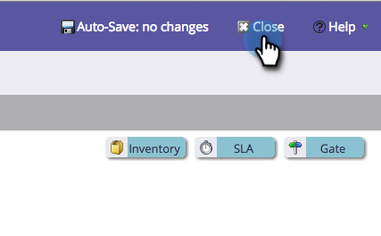

# Modification du nom d’une étape {#changing-the-name-of-a-stage}

Changer d&#39;avis ? Pas un problème. Il est facile de renommer une étape du modéliseur de cycle de recettes.

1. Accédez à la zone **[!UICONTROL Analytics]**.

   

1. Sélectionnez un modéliseur de cycle de revenus à mettre à jour. Cliquez sur **[!UICONTROL Modifier le brouillon]**.

   

1. Sélectionnez l’étape à mettre à jour et saisissez un nouveau **[!UICONTROL Nom]**.

   

1. Cliquez sur **[!UICONTROL Fermer]**.

   

   Tu vois ? Doucement ! N’oubliez pas de [Approuver votre modèle](/help/marketo/product-docs/reporting/revenue-cycle-analytics/revenue-cycle-models/approve-unapprove-a-revenue-model.md).
