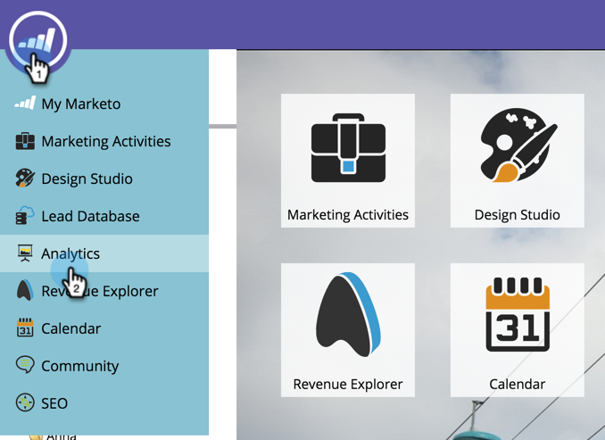
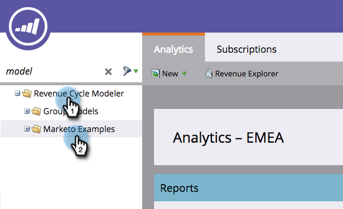
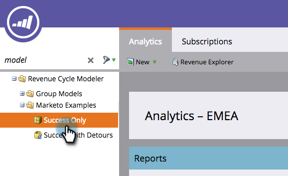
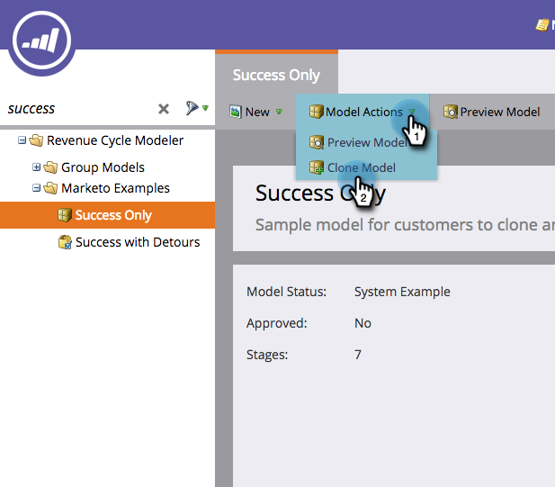
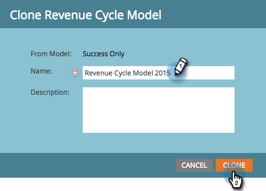

# Clonage d’un modèle d’exemple de revenu Marketo {#cloning-a-marketo-example-revenue-model}

Marketo dispose d’exemples de modélisateurs de chiffre d’affaires pour vous inspirer. Clonez ces modéliseurs et créez-les les vôtres. Voici comment procéder :

1. Accédez à la zone **[!UICONTROL Analytics]**.

   

1. Sélectionnez le dossier **[!UICONTROL Revenue Cycle Modeler]**, puis cliquez sur **[!UICONTROL Exemples Marketo]**.

   

1. Choisissez l&#39;un des modéliseurs.

   

1. Dans [!UICONTROL Actions du modèle], sélectionnez **[!UICONTROL Cloner le modèle]**.

   

1. Saisissez un **[!UICONTROL Nom]** et cliquez sur **[!UICONTROL Cloner]**.

   

   Si seulement générer des revenus était aussi facile !
