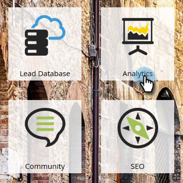
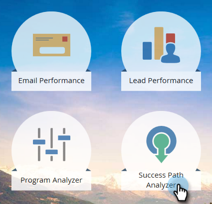
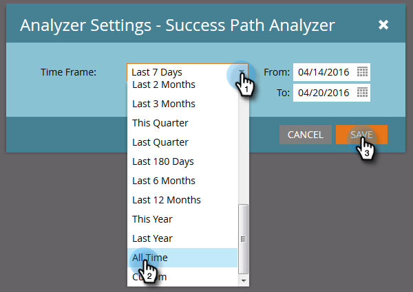
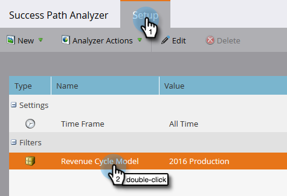
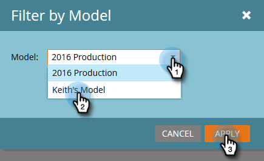
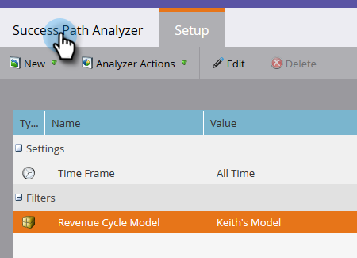

# Créer un analyseur du parcours de réussite {#create-a-success-path-analyzer}

Obtenez une représentation visuelle de la vitesse et du flux dans votre modèle de cycle du chiffre d’affaires.

>[!PREREQUISITES]
>
>[Création d’un modèle de chiffre d’affaires](/help/marketo/product-docs/reporting/revenue-cycle-analytics/revenue-cycle-models/create-a-new-revenue-model.md)

1. Cliquez sur la mosaïque **[!UICONTROL Analytics]**.

   

1. Cliquez sur l’icône **[!UICONTROL Analyseur de chemin de réussite]**.

   

   >[!NOTE]
   >
   >Si vous recevez un avertissement indiquant qu’aucune donnée n’a été trouvée dans le délai spécifié, cliquez simplement sur **[!UICONTROL Fermer]** pour modifier votre délai. Si vous n’y êtes pas invité, mais que vous souhaitez modifier votre période, accédez à **[!UICONTROL Configuration]** et double-cliquez sur **[!UICONTROL Période]**.

1. Si vous ne disposez d’aucune donnée ou si vous modifiez votre période, sélectionnez-en une dans la liste déroulante et cliquez sur **[!UICONTROL Enregistrer]**.

   

   >[!TIP]
   >
   >Pour sélectionner une plage spécifique, sélectionnez **[!UICONTROL Personnalisé]** et utilisez les champs **[!UICONTROL De]** et **[!UICONTROL À]**.

1. Si vous disposez de plusieurs modèles de cycle de revenus, sélectionnez celui de votre choix dans l&#39;onglet **[!UICONTROL Configuration]**.

   

1. Sélectionnez le modèle approprié et cliquez sur **[!UICONTROL Appliquer]**.

   

1. Cliquez sur l’onglet **[!UICONTROL Analyseur de chemin de réussite]**.

   

Maintenant, vous pouvez explorer le mouvement de chaque étape à la suivante !

>[!TIP]
>
>Vous souhaitez enregistrer votre rapport ? Cliquez sur la liste déroulante **[!UICONTROL Actions de l’analyseur]** et sélectionnez **[!UICONTROL Enregistrer sous]**.

>[!MORELIKETHIS]
>
>[Utilisation de l’analyseur de chemin de succès](/help/marketo/product-docs/reporting/revenue-cycle-analytics/revenue-cycle-models/using-the-success-path-analyzer.md)
