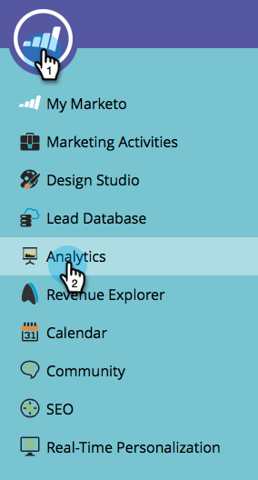
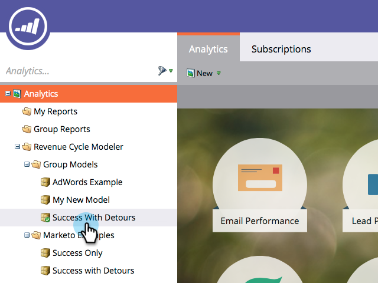
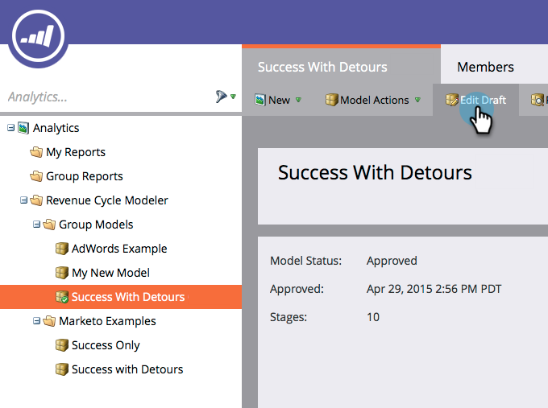
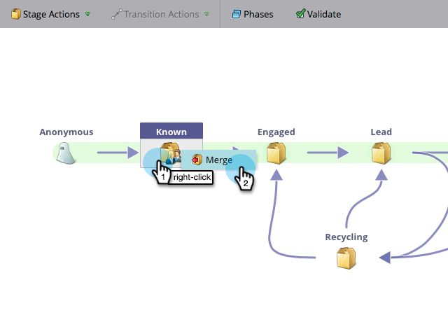
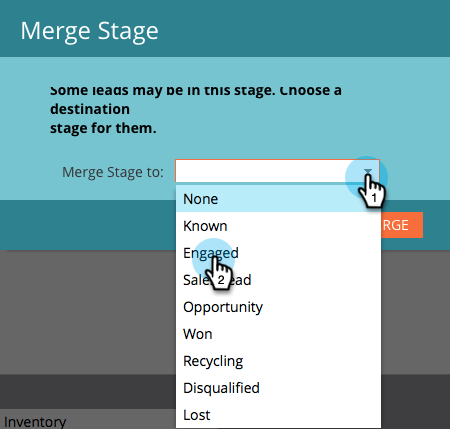
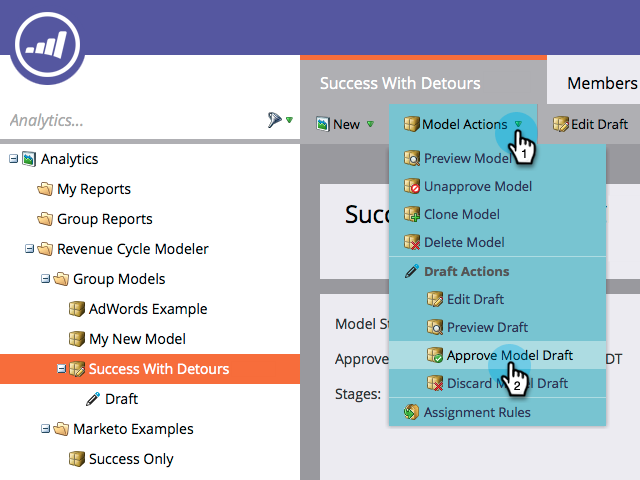

# Fusion de deux étapes dans Revenue Modeler {#merging-two-stages-in-the-revenue-modeler}

Après avoir approuvé le modèle, vous ne pouvez pas supprimer de phases lors de la modification d’un brouillon. Vous pouvez plutôt fusionner cette étape avec une autre.

1. Cliquez sur **Accueil** puis sélectionnez **[!UICONTROL Analytics]**.

   

1. Cliquez sur le modèle approuvé.

   

1. Cliquez sur **[!UICONTROL Modifier le brouillon.]**

   

1. Cliquez avec le bouton droit sur l’étape à fusionner et sélectionnez **[!UICONTROL Fusionner] Étape** dans le menu.

   

1. Cliquez sur l’étape spécifique dans le menu déroulant.

   

1. Vous pouvez approuver à nouveau le modèle en sélectionnant **[!UICONTROL Approuver le brouillon de modèle]** dans le menu **[!UICONTROL Actions de modèle]**.

   

>[!NOTE]
>
>Sélectionnez **[!UICONTROL Aucun]** dans le [!UICONTROL étape de fusion] pour supprimer les prospects de votre modèle
