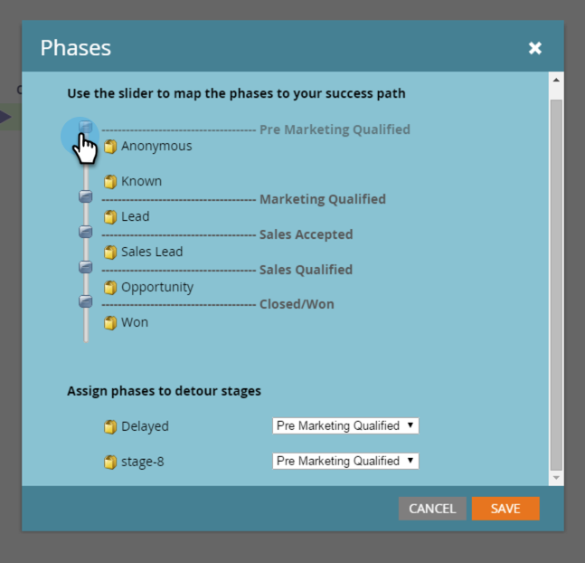

# Présentation des phases du modèle de revenus {#understanding-revenue-model-phases}

Les phases permettent de regrouper un certain nombre de phases. Parfois, plusieurs étapes d’un modèle reflètent une phase d’un funnel.

## Définition des phases du modèle {#define-the-phases-of-the-model}

1. Cliquez sur **[!UICONTROL Phases]**.

   

1. Cliquez sur le bouton bleu pour faire glisser les phases vers le haut et vers le bas à travers les étapes.

   
