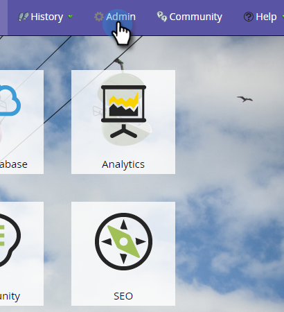

# Activation de la synchronisation de champ personnalisé pour [!UICONTROL Revenue Cycle Analytics] {#enabling-custom-field-sync-for-revenue-cycle-analytics}

Les étapes suivantes vous permettront d’utiliser des champs personnalisés dans les rapports RCA.

1. Cliquez sur **[!UICONTROL Admin]**.

   

1. Cliquez sur **[!UICONTROL Revenue Cycle Analytics]**, puis **[!UICONTROL Custom Field Sync]**.

   

1. Sélectionnez votre **[!UICONTROL Nom du champ]**, puis cliquez sur **[!UICONTROL Modifier option de synchronisation]**.

   

1. Sous **[!UICONTROL État de la synchronisation]**, sélectionnez **[!UICONTROL Activé]**, puis cliquez sur **[!UICONTROL Enregistrer]**.

   

1. La vérification verte vous permet de savoir que le champ est configuré pour la synchronisation.

   

   Et c&#39;est ça !

   >[!NOTE]
   >
   >Une fois le champ activé, les données sont disponibles le lendemain dans [!UICONTROL Revenue Cycle Analytics].
